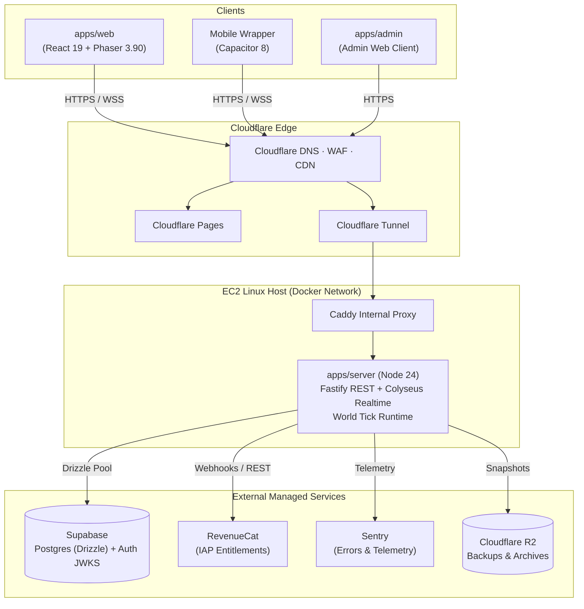
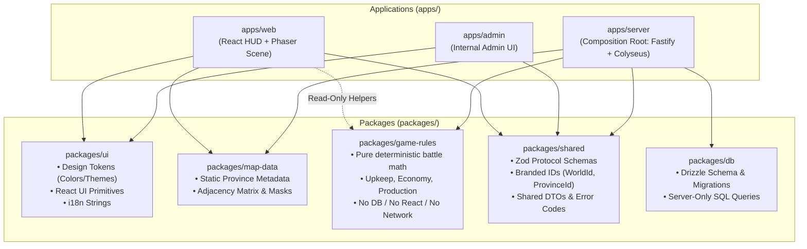

# AGENTS.md — WARGAME implementation rules

> **Read this before changing code.**
> **Game authority:** [`specs/09-v1-design-lock.md`](specs/09-v1-design-lock.md) wins over every other file.
> **Planning authority:** `plan/01`–`plan/08`, `plan/schemas/*`, and `plan/tasks.json`.
> **Docs rules:** [`specs/AGENTS.md`](specs/AGENTS.md) still applies when editing specs.
> This file governs how work is done. It never overrides a `LOCKED`, `DEFAULT`, or `TBD` game rule.

## 1. Read order

1. `specs/09-v1-design-lock.md` — the v1 lock.
2. The relevant `plan/0X` document and `plan/schemas/*`.
3. `plan/08-screens-and-hud.md` for any UI surface.
4. `plan/07-implementation-plan.md` and the task in `plan/tasks.json`.
5. `specs/AGENTS.md` if editing specs.
6. This file.

For codebase questions, follow the global graphify rule: use `graphify query`, `graphify path`, or `graphify explain` before broad grep when `graphify-out/` exists. Run `graphify update .` after code changes when the graph is present.

## 2. Non-negotiables

- **Never implement a `PROPOSED`, `TBD`, or unresolved decision.** Stop and ask one question at a time.
- **Never silently change `LOCKED`, `DEFAULT`, or `TBD`.** A spec change needs explicit approval and a document update.
- **The server decides every gameplay outcome.** The client sends intents and renders server state. No client-side combat, loot, resource spend, timer, or random outcome.
- **No pay-to-win.** Purchases are cosmetic only. No paid power, premium currency, loot boxes, or paid pass levels.
- **No hardcoded colors.** Use the design-token source of truth (§6).
- **No hardcoded user-facing strings.** Use the i18n catalog (§7).
- **No hardcoded gameplay numbers.** Approved values live in versioned config; the server pins the config version/hash per world.
- **No secrets in the repo or client.** No `service_role`, RevenueCat secret, database URL, or private key in web/mobile code.
- **No new dependency, service, or platform without approval.** Use the pinned stack in `plan/04`.
- **Typecheck, lint, tests, and build must pass before “done.”** No exceptions, no `--no-verify`.
- **Accessibility is part of the feature**, not a later polish task.
- **Do not commit, push, deploy, or change cloud resources unless the user explicitly asks.**
- **Do not rewrite or delete another person's work.** Investigate first; preserve unrelated changes.

## 3. Use the right skill

Load a skill with the `skill` tool at the start of the task. Use the **most specific** matching skill; do not load the whole catalog.

| Work                                                     | Load first                         | Notes                                                         |
| -------------------------------------------------------- | ---------------------------------- | ------------------------------------------------------------- |
| HUD, menus, sheets, safe areas, focus, screen flow       | `game-ui-ux`                       | The primary UI skill for this game.                           |
| Phaser scene, config, loader, map renderer               | `phaser-core`                      | Phaser 3.90.0 only.                                           |
| Touch, keyboard, input mapping, buffering                | `input-systems`                    | Touch + mouse/keyboard. **No gamepad.**                       |
| Map pan/zoom, fit-to-width, camera bounds                | `camera-systems`                   | No minimap or +/- controls.                                   |
| Screen shake, hit-stop, impact feedback                  | `game-feel`                        | Respect reduced motion.                                       |
| Low FPS, stutter, draw calls, memory                     | `performance-optimization`         | Measure with the profiler before changing code.               |
| Playwright game tests, visual/gameplay checks            | `qa-game`                          | Use the Playwright MCP for browser execution.                 |
| Debugging a failing game test                            | `game-qa`                          | Reference skill; use `qa-game` to add tests.                  |
| React page or marketing/landing UI                       | `frontend-design`                  | Do not use generic landing-page patterns for the in-game HUD. |
| Test-first feature or bug fix                            | `tdd`                              | Red → green → refactor; each bug gets a regression test.      |
| Multi-step task or long investigation                    | `planning-with-files`              | Keep `task_plan.md`, `findings.md`, `progress.md` current.    |
| Supabase client, Auth, Realtime, Storage, Edge Functions | `supabase`                         | Use the Supabase MCP/CLI where appropriate.                   |
| Postgres schema, migrations, RLS, indexes, queries       | `supabase-postgres-best-practices` | **Always load before changing the database.**                 |
| Cloudflare Pages, Tunnel, R2, DNS/WAF                    | `cloudflare`                       | Use `wrangler` for Pages/CLI work.                            |
| Cloudflare Workers/Functions (only if approved)          | `workers-best-practices`           | v1 does not require a Worker by default.                      |
| Code review before merging                               | `clean-code-guard`                 | Review changed production code, not test code.                |
| Review a branch/PR against standards + spec              | `code-review`                      | Use for a real review request, not a quick edit.              |
| Bug diagnosis                                            | `diagnosing-bugs`                  | Reproduce before fixing.                                      |
| Docs/README/API reference changes                        | `docs-guard`                       | Verify every command, flag, and example.                      |
| iOS dependency/project changes                           | `xcode-project-setup`              | SPM/Capacitor 8.                                              |
| App Store submission/review                              | `app-store-review`                 | Only for submission readiness.                                |

Rules for skills:

- If no skill matches, say so and proceed; do not force an unrelated skill.
- If two skills conflict, the more specific one wins; `09` wins over both.
- Do **not** use `phaser-arcade-physics`: this game has no physics engine, no rigid bodies, and no client-side movement simulation.
- Do **not** use Firebase, Stripe, PWA-only, Jest, Redux, Tailwind/shadcn, or React Native skills for this stack unless the decision is explicitly changed.
- Do **not** use `app-store-optimization` or marketing skills for gameplay code.

## 4. Task workflow

1. Pick a task from `plan/tasks.json`; read its acceptance criteria, tests, decision gates, and `blockedBy`.
2. If the task or a dependency is blocked by a `TBD` or an open gate, stop and ask. Do not “work around” it.
3. Read the relevant docs and the screen spec before editing.
4. Load the matching skill.
5. For a core rule, write the failing test first. For a UI change, define the states and acceptance check first.
6. Implement the smallest coherent change. Keep changes inside the task.
7. Run the required checks (§11).
8. Update the task status/evidence and `progress.md` only after the checks pass.
9. Do not commit/push/deploy unless asked.

## 5. Code structure, architecture map, and quality

- TypeScript strict mode, ESM, `tsc -b`; no `any`, no `@ts-ignore`, no non-null `!` unless the invariant is proven and documented.
- Validate every external boundary with Zod: REST, WebSocket messages, webhooks, env, config, and DB rows where needed.
- Keep pure rules in `packages/game-rules`; it imports no Node, browser, DB, network, or React code.
- Keep `packages/shared` free of app, DB, and UI code.
- `packages/db` is server-only. Web/admin never import it and never use a service-role key.
- `packages/ui` contains tokens, i18n, and React primitives only; no game authority and no network calls.
- `apps/server` is the composition root; it wires Fastify, Colyseus, DB, and integrations.
- Prefer small named exports and explicit types at module boundaries. No catch-all barrel files that create cycles.
- No `console.log` in production paths; use pino on the server and Sentry for errors. No PII in logs.
- No dead code, commented-out code, or `TODO` without an issue/task reference.
- No floating promises. Handle cancellation and cleanup in effects, rooms, and subscriptions.
- No `dangerouslySetInnerHTML`.
- Use the stable error envelope and error codes; never render raw server errors.
- Parse and format time in UTC on the server. Use `Intl` for display; never derive game rules from the device clock.
- Inject the clock and seeded RNG into game rules. No `Date.now()`, `new Date()`, or `Math.random()` inside pure rules or combat resolution.
- No raw `fetch` in components. Use the typed API client and shared protocol types; add endpoints to `/api/v1` and the shared contract, never ad hoc strings.
- Use branded IDs (`AccountId`, `WorldId`, `ProvinceId`, `CommandId`); do not pass raw strings or numbers across boundaries.
- No magic layout numbers. Spacing, radii, z-index, breakpoints, and motion durations come from tokens.

### 5.1 System runtime topology



### 5.2 Workspace package architecture & dependency map

Dependencies flow strictly downward. Packages never import from higher-level apps or peer packages they do not depend on:



### 5.3 Physical repository layout

```text
wargame/
├── apps/
│   ├── web/                    # React 19 + Phaser 3.90 browser/mobile client
│   │   ├── src/
│   │   │   ├── app/            # Shell, Router, Providers
│   │   │   ├── map/            # Phaser Scene, camera, input, textures
│   │   │   ├── screens/        # React HUD overlays (Province, Market, Army)
│   │   │   └── realtime/       # Colyseus client connection & StateView adapter
│   ├── server/                 # Fastify + Colyseus composition root
│   │   ├── src/
│   │   │   ├── http/           # REST endpoints (/api/v1/*)
│   │   │   ├── realtime/       # Colyseus rooms, ticks, command validation
│   │   │   ├── systems/        # Orchestration (combat, production, timers)
│   │   │   └── persistence/    # Snapshot writer & replay workers
│   └── admin/                  # Internal admin dashboard
│
├── packages/
│   ├── shared/                 # Protocol schemas, DTOs, branded IDs (Zero dependencies)
│   ├── game-rules/             # Pure deterministic functions (Vitest-tested)
│   ├── ui/                     # Design tokens, theme CSS, Radix UI primitives
│   ├── map-data/               # Static Vardania geometry, borders, provinces
│   └── db/                     # Drizzle schema, migrations (SERVER ONLY)
│
└── infra/                      # Docker, Caddyfile, Cloudflare tunnel scripts
```

### 5.4 Feature expansion and seasonal theming rules

- **Adding a new feature:** Flow changes through the 4 tiers in order:
  1. `packages/shared`: Declare command, event schemas, DTOs, and error codes.
  2. `packages/game-rules`: Implement pure math and state transitions (unit-testable in Vitest without network or DB).
  3. `apps/server`: Handle command validation, execute pure rule, persist durable transaction, broadcast delta.
  4. `apps/web`: Implement HUD sheet and map entity visuals using the shared contracts.
- **Seasonal themes (e.g. Halloween, Holiday):**
  1. Defined strictly inside `packages/ui/src/tokens/themes/` (e.g. `halloween.css` overriding semantic tokens like `--color-accent` and `--color-surface`).
  2. No raw color overrides in component files; components consume semantic tokens only.
  3. Phaser imports token maps from `packages/ui` (`COLORS`), guaranteeing synchronization with the React HUD.
  4. The web shell activates themes via root attribute (e.g., `<body data-theme="halloween">`), controlled by remote config. Deactivation requires zero component-level diffs.

## 6. Colors and design tokens

There must be **one token source of truth** for web, mobile, and Phaser. Use the layout in `plan/05` (`packages/ui`) and confirm exact filenames in P1.

Rules:

- No raw `#hex`, `rgb()`, `hsl()`, or named CSS colors in `apps/**` or `packages/ui/**` outside the token source and tests.
- No `0x...` color literals in Phaser scenes. Import the shared `COLORS` token map.
- Components consume **semantic** tokens (`--color-surface`, `--color-text`, `--color-accent`, `--color-danger`), not palette names directly. Palette tokens are for the token layer.
- Alpha is expressed with token variants or `color-mix(...)`; do not invent a new color by changing opacity ad hoc.
- No inline color styles. Inline styles are allowed only for dynamic geometry/transform values.
- Province colors are **data**: `packages/map-data` owns color-family IDs; the UI maps IDs to tokens. No hex in map components.
- Every text/background pair used for small text must pass WCAG AA; color is never the only carrier of meaning (pattern + emblem + shape required).
- No new hue outside the 16-color palette. No gradients, glassmorphism, or full-screen CRT filters.
- Add a lint/check that fails on raw color literals outside the token layer. A stylelint rule or equivalent is acceptable; the check must run in CI.
- Update tokens in one place; generate CSS variables and the TS/Phaser map if needed. Do not manually keep two palettes in sync.

## 7. Strings and localization

- All user-facing text lives in the i18n catalog, e.g. `packages/ui/src/i18n/en.ts` (confirm path in P1).
- No English string literals in JSX/TSX, buttons, labels, placeholders, toasts, empty states, dialogs, `aria-label`, `alt`, page titles, or error copy.
- Use key-based lookups: `t('market.listing.buy')`. Never `t('Buy now')`.
- Use ICU messages for plurals, counts, dates, and numbers. No sentence concatenation.
- Server responses return stable machine codes and structured details. The client maps codes to i18n keys; server `message` is developer-facing only.
- Content data (province names, faction names, emblems, map labels) comes from `packages/map-data` or the database, not from component literals.
- Tests use roles, labels from keys, or `data-testid`; do not assert against English copy.
- Add keys in the same change that uses them. A missing key must fail the build/test, not silently render the key or English fallback.
- Do not hardcode `en`; the default locale is configuration. Do not add a language switcher until the locale plan is approved.
- Allowed literals: logs, analytics event names, protocol enum values, CSS class names, test descriptions, and developer-only diagnostics.

## 8. Gameplay and server authority

- Client → server command → validate → apply in memory → append input + receipt in one DB transaction → ack → broadcast delta. No state delta before a durable commit.
- Do not show a resource deduction, capture, or queue change until the server acknowledges it.
- No duplicate sends on reconnect; use command IDs and idempotency.
- Exact enemy troop counts never enter the shared Colyseus schema. Expose public bands plus private maps only to the owner/allies.
- No fog of war. Support is public. Own/allied counts are exact. Enemy counts are bands. Allies do not see each other's resources, queues, research, or missions.
- Battle reports are participant-only (DOC DEFAULT; confirm at G0). Any public summary omits exact counts and battle math.
- All gameplay values come from versioned config: production, upkeep, costs, timers, power, losses, support, trade limits, pass XP, and rewards. No magic numbers.
- AI decisions are audit-only events; replay skips them and recomputes AI from snapshot + seed + config.
- World clock derives from `world.started_at`; days clamp 1–30; war window is server UTC.
- Do not add chat, email OTP, email reminders, push notifications, gamepad support, user uploads, or free-text social surfaces.

## 9. Data, security, and privacy

- PostgreSQL/Supabase is the database. Use Drizzle migrations; never make schema changes by hand or through the SQL console.
- Use the runtime least-privilege DB role. RLS is enabled; test it. The browser never gets `service_role`.
- Use explicit column lists; no `select *` in runtime queries. Parameterize SQL; never interpolate input.
- Write world state plus its input/event receipt in one transaction. Snapshots are accelerators, not ack dependencies.
- Verify Supabase JWTs with JWKS server-side. Never trust a client user ID or entitlement claim.
- RevenueCat is the purchase authority. Verify webhooks/raw body, idempotency, product/entitlement mapping, and server-side restore. No client receipt trust.
- Rate-limit auth, commands, trades, and webhooks. CORS is an allowlist, not `*`.
- Strict CSP; no third-party scripts; no secrets in bundles; no PII in Sentry or logs.
- Use the Supabase SDK's supported session storage. Do not hand-roll token storage, put tokens in URLs, or add a second auth store. Mobile tokens use Keychain/Keystore via the approved secure-storage plugin.
- No analytics or external tracking until the metrics decision is closed. Sentry is the only external observability service; no PostHog, GA, Amplitude, or ad SDKs.
- Account merge follows `09`: keep the existing social account; a conflicting guest faction is abandoned after confirmation; non-conflicting guest factions may be reassigned.
- No email field in the app. No real names, countries, leaders, parties, or weapons. Use invented/generic names.
- Admin is a separate protected surface with audit logs; no player room token, no direct SQL console.

## 10. UI, UX, and mobile

- Phone-first baseline **390×844**; desktop is the same components in a wider layout with a ~380px right context panel.
- React owns the HUD, sheets, and menus. Phaser owns the map canvas. One state adapter; components do not subscribe to raw Colyseus schema objects.
- Use the design tokens, CSS Modules, and Radix primitives. No Tailwind, shadcn, styled-components, or emotion unless approved.
- Minimum touch target 44×44px; no hover-only actions; visible focus; keyboard parity; Esc/back behavior.
- Support 200% text scaling, safe areas, reduced motion, screen-reader labels, and colorblind patterns/emblems.
- One modal layer at a time; the map stays as context. Do not stack sheets.
- Every surface needs loading, empty, error, offline/reconnect, and disabled states where applicable.
- No dead buttons. If a rule is TBD, hide the control or disable it with a reason.
- Do not show a second buy CTA while a pass is active; repeat purchase/stacking is TBD.
- Web shop/pass is browsable but has no checkout. All purchases are mobile IAP.
- No gamepad. Touch + mouse/keyboard only.
- No offline play. Offline defense is server-side only; the client shows server state on return.
- Use `game-ui-ux` for HUD/menu decisions and `design-game` for visual polish; do not use generic landing-page patterns for the in-game HUD.
- Do not put authoritative game state in React, Phaser, or Zustand; those are projections.

## 11. Tests and required checks

P1 must provide these canonical root scripts. Until they exist, a task cannot be marked done by improvising a command.

```bash
pnpm install --frozen-lockfile
pnpm typecheck
pnpm lint
pnpm format:check
pnpm test
pnpm build
pnpm test:e2e        # required for UI changes
pnpm validate:tasks  # required for planning/task changes
```

Rules:

- Run the narrowest relevant checks while working; run the root gate before claiming done.
- Unit tests: Vitest for pure rules (production, upkeep, combat, capture, support, trade, research, pass XP, visibility banding).
- Integration: migrations, command receipt, snapshot/replay, lease, account merge, RevenueCat webhook.
- Room: join, command, StateView, reconnect, tick, season freeze.
- E2E: Playwright for guest onboarding, join, capture, reconnect, shop read-only, pass display, 390px and 1280px.
- Always test the StateView leakage case: an enemy client must not receive exact troop/resource/queue fields.
- Always test deterministic replay: same snapshot + ordered inputs + seed → same state hash.
- Accessibility: axe/keyboard/focus/reduced-motion checks; visual regression at 390px and desktop.
- Performance: profile before optimizing; check map repaint, draw calls, and frame budget.
- Bug fix = regression test. No `test.only` committed. No arbitrary `sleep`; use fake timers and seeds.
- Do not disable lint/type rules to get green. If a rule is wrong, propose a change with evidence.

## 12. Dependencies, tooling, and services

- Use latest stable compatible packages, then pin exact versions in `pnpm-lock.yaml`, Docker digests, and mobile build files. No floating `latest`.
- Node **24.22.1 LTS**, pnpm **12.15.0**, TypeScript **7.0.2** (6.x fallback only via ADR), Vite **8.3.5**, React **19.3.1**, Phaser **3.90.0**, Colyseus **0.18.x**, Fastify **5.12.7**, Drizzle **0.45.4**, `pg` **8.23.1**, Supabase JS **2.118.0**, RevenueCat **13.7.6**, Capacitor **8.5.3**, Sentry **11.8.0**, Zustand **5.0.16**, Howler **2.2.4**, Zod **4.6.7**, jose **6.2.13**, pino **10.4.0**, Vitest **5.0.5**, Playwright **1.64.1**.
- Do not add alpha/beta releases. Do not mix TypeScript versions across packages.
- No Firebase, Stripe, CloudWatch, Grafana, or a second observability service. Sentry + local rotating pino logs only.
- Existing AWS EC2 + Docker Compose + Caddy + Cloudflare Tunnel; existing Supabase and Cloudflare accounts. No new VPS, no inbound web ports.
- Cloudflare: DNS/WAF/CDN/Pages/R2. v1 does not need Workers by default.
- Mobile: Capacitor 8.5.3, Android + iOS, SPM, Xcode 26+. Do not add native crash capture to Sentry without an approved solution.
- RevenueCat: mobile IAP only; web read-only; server-side entitlement truth.
- If a dependency cannot typecheck under TS 7, record the fallback ADR; do not quietly downgrade.

## 13. Git, review, and tracking

- Keep commits small and scoped to one task. Include the task ID in the commit message.
- Never commit `node_modules`, build output, `.env`, secrets, generated snapshots, or local logs.
- Do not commit generated files except Drizzle migrations and approved static map data. Do not update the lockfile without an approved dependency change.
- Do not amend/rewrite history or force-push unless asked. Run `git diff --check` and a secret scan before presenting a change.
- Before a PR: summarize the task, acceptance evidence, tests run, screenshots for UI, risks, and any open decision.
- Update `plan/tasks.json` status and evidence when a task is done. Update `task_plan.md` only when a phase/gate changes.
- Review production code with `clean-code-guard`; review tests separately. Do not treat a passing test as proof of clean code.
- If you find a new assumption, log it in the appropriate doc/spec and mark it `DEFAULT` or `TBD`; do not bury it in code.

## 14. Definition of done

A task is done only when all apply:

- [ ] The task ID and acceptance criteria are satisfied.
- [ ] Required tests exist and pass; a bug fix has a regression test.
- [ ] `pnpm typecheck`, `pnpm lint`, `pnpm format:check`, `pnpm test`, and `pnpm build` pass (or the affected package filters plus the root gate).
- [ ] UI changes pass Playwright at 390px and desktop, plus keyboard/axe/reduced-motion checks.
- [ ] No hardcoded colors, user-facing strings, gameplay numbers, secrets, URLs, or product IDs.
- [ ] No `TBD`/`PROPOSED` behavior shipped; no silent spec override.
- [ ] Server authority, StateView privacy, and command idempotency are preserved.
- [ ] Config/docs/decision log are updated for any new value or assumption.
- [ ] No new dependency/service without approval and exact pin.
- [ ] Evidence is recorded in the task/progress log.

## 15. Prohibited shortcuts

- Client-authoritative combat, resources, timers, loot, or RNG.
- Exact enemy counts in shared client state.
- `service_role` keys, secrets, or privileged DB access in web/mobile.
- Raw hex/color names in components or Phaser scenes.
- English copy in components; string concatenation for sentences.
- Magic gameplay numbers in code.
- `any`, `@ts-ignore`, disabled lint rules, or skipped tests to get green.
- `dangerouslySetInnerHTML`, third-party scripts, or a weakened CSP.
- Chat, email OTP, email reminders, push, gamepad, user uploads, or free-text social surfaces.
- Web checkout, Stripe, paid power, loot boxes, randomized paid cosmetics, or paid pass levels.
- Phaser Arcade Physics or client-side movement simulation.
- A second state library, second renderer, or second source of design tokens.
- Commit/push/deploy without explicit approval.
