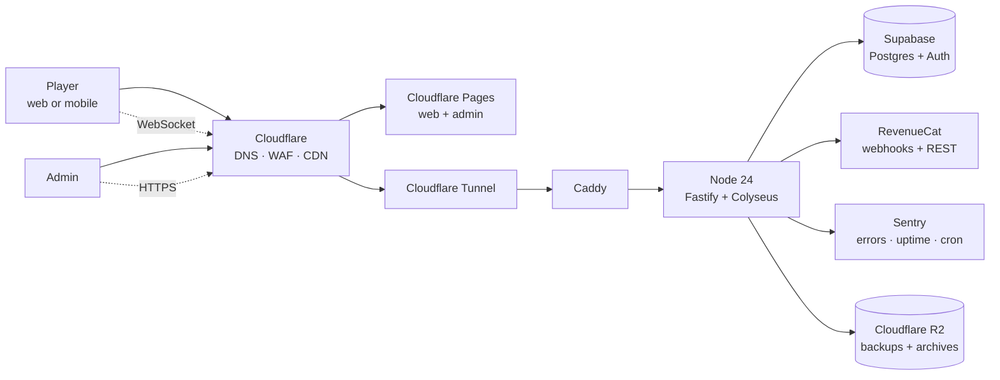

# 05. System Architecture

> **Project:** The Succession
> **Document:** `plan/05-architecture.md`
> **Version:** 1.0 — architecture baseline
> **Date:** 2026-10-23
> **Status:** Draft for technical and product-owner review
> **Authority:** [`specs/09-v1-design-lock.md`](../specs/09-v1-design-lock.md) is the v1 design authority. [`plan/04-technology-decisions.md`](04-technology-decisions.md) selects the technology. This document assigns responsibilities and defines data flow. If this document conflicts with `09`, `09` wins unless the conflict is an approved spec delta recorded in `04` §17.
> **Companions:** [`plan/01-requirements.md`](01-requirements.md), [`plan/02-game-design.md`](02-game-design.md), [`plan/03-gameplay-rules.md`](03-gameplay-rules.md), and [`plan/04-technology-decisions.md`](04-technology-decisions.md).
> **Audience:** Engineering, QA, operations, security, and product.

---

## 1. Purpose and reading guide

This document divides the game into modules, defines each module’s responsibilities, and shows how data moves between the client, the game server, the database, and external services.

It covers:

- rendering, input, entities, gameplay systems, UI, audio, level management, asset loading, persistence, and platform integration;
- state ownership and authority;
- the command/tick/snapshot/recovery model;
- authentication, account linking, payments, and administration;
- security boundaries, failure modes, testing seams, deployment, and the repository layout.

It does **not** define final balance values, visual comps, legal terms, or implementation code.

### 1.1 Status tags

| Tag | Meaning |
|---|---|
| **LOCKED** | Fixed by `09`. Do not change without a design-lock revision. |
| **DECIDED** | Chosen in `04` or by explicit product-owner approval. |
| **PROPOSED** | A recommended architecture default. Not final until reviewed. |
| **TBD** | Undecided. Stop and ask; do not invent a value or flow. |

`PROPOSED` is not a fourth game status. It is a planning marker; it is effectively TBD until approved.

### 1.2 Architecture principles

1. **The server is the only gameplay authority.** The client sends intents and renders projections.
2. **One writer per world.** A world room is owned by one process at a time, enforced by a lease.
3. **State is projected, not filtered in the UI.** Hidden values must never leave the server.
4. **Durable state is snapshot + ordered inputs.** A crash must not require a human to reconstruct the world.
5. **The database is not in the tick loop.** Live simulation is in memory; durable writes are event/snapshot writes.
6. **One deployable game service for v1.** Fastify and Colyseus share a process.
7. **Managed services at the edges.** Supabase, Cloudflare, RevenueCat, and Sentry remove operations the team should not own.
8. **No hidden coupling.** Shared packages have one direction of dependency; gameplay rules do not import server or client code.
9. **Every irreversible action is idempotent and audited.**
10. **Every TBD has a seam.** A missing value is config or an interface, never an invented constant.

---

## 2. System context



### 2.1 Actors

| Actor | Responsibility |
|---|---|
| Player | Plays the web or Capacitor client; authenticates as guest or Google/Apple; sends intents; views projections. |
| Admin | Uses a separate internal web app to moderate names, inspect worlds, grant/revoke entitlements, pause/resume worlds, and audit actions. |
| Cloudflare | Terminates edge TLS, applies WAF/rate limits, serves static clients, tunnels game traffic, stores backup exports. |
| EC2 app | Runs Fastify REST, Colyseus rooms, the world runtime, persistence worker, and RevenueCat webhook handler. |
| Supabase | Owns Postgres and Auth; issues and verifies identities; stores durable game data. |
| RevenueCat | Owns mobile purchase records and entitlement events. |
| Sentry | Receives error/performance events, uptime checks, and cron heartbeats. |
| R2 | Stores encrypted database dumps and archived event logs. |

### 2.2 Trust boundaries

| Boundary | Trust rule |
|---|---|
| Client → Cloudflare | Untrusted input; TLS; WAF/rate limits; no client secret. |
| Cloudflare → Caddy → app | Tunnel-authenticated edge traffic; app still authenticates every request. |
| App → Supabase | Server-only credentials; never exposed to the client. |
| App → RevenueCat | Server-only secret for REST; webhook authorization verified. |
| Admin → app | Supabase JWT plus admin role/allowlist; audited. |
| App → Sentry/R2 | Outbound only; secrets server-side; PII scrubbed. |

---

## 3. Runtime topology

### 3.1 Processes and containers

```
EC2 Linux host
├── cloudflared        (outbound tunnel; no published ports)
├── caddy              (internal reverse proxy; port 80 inside Docker network)
└── app                (Node 24; port 8080 inside Docker network)
    ├── Fastify         /api/v1/*
    ├── Colyseus        matchmaking + WebSocket
    ├── WorldRuntime    one scheduler per active world
    ├── Persistence     snapshot/event writers, lease heartbeat
    └── Integrations    Supabase, RevenueCat, Sentry
```

- No Postgres, Redis, or Firebase container; no Firebase service is used in v1.
- This is the existing EC2 host; v1 does not add a new VPS.
- The app binds to the Docker network only; Caddy is the only service that talks to it.
- `cloudflared` is the only ingress from Cloudflare.
- The host has outbound HTTPS for Supabase, RevenueCat, Sentry, and Cloudflare.

### 3.2 Startup sequence

1. Validate environment and config schema.
2. Initialize Sentry and structured logging.
3. Open the Postgres pool (runtime role).
4. Verify the latest migration is applied; fail readiness if not.
5. Verify Supabase JWKS is reachable; cache keys.
6. Acquire leases for worlds assigned to this process (v1: all active/assigned worlds; future: an assignment service).
7. For each leased world: load latest snapshot, replay inputs, catch up ticks, start the room scheduler.
8. Start Fastify and Colyseus.
9. Mark `/readyz` healthy only when all assigned worlds are loaded or explicitly paused.
10. Start the lease heartbeat and Sentry cron heartbeat.

If a world fails to load, the process still starts; that world is marked `quarantined`, admin-visible, and does not accept joins. A single corrupt world must not block the others.

### 3.3 Ports and hostnames

| Hostname | Path | Destination |
|---|---|---|
| `app.example.com` | `/` | Cloudflare Pages web client |
| `admin.example.com` | `/` | Cloudflare Pages admin client (hosting **PROPOSED**) |
| `game.example.com` | `/api/v1/*` | Fastify |
| `game.example.com` | `/matchmake/*`, WebSocket paths | Colyseus |
| `game.example.com` | `/healthz`, `/readyz` | Fastify health |
| `game.example.com` | `/api/v1/webhooks/revenuecat` | Fastify webhook |

Exact domains are **TBD**.

---

## 4. Repository and module map

```
wargame/
├── apps/
│   ├── web/                 React + Phaser browser/mobile client
│   ├── admin/               Internal admin web client
│   └── server/              Fastify + Colyseus process
├── packages/
│   ├── shared/              Protocol schemas, DTOs, errors, time, config contracts
│   ├── game-rules/          Pure domain rules and state transitions
│   ├── map-data/            Static Vardania mask, adjacency, province metadata
│   ├── db/                  Drizzle schema, migrations, server-only queries
│   ├── ui/                  Design tokens and shared React primitives
│   └── test-bot/            Deterministic bot/load client
├── infra/
│   ├── docker/              Dockerfiles, Compose, Caddyfile, cloudflared config
│   ├── github/              CI workflows
│   ├── cloudflare/          Pages/Tunnel/R2 configuration notes
│   └── scripts/             Backup, restore, migration, release helpers
├── plan/
└── specs/
```

### 4.1 Dependency direction

```
apps/web ──► packages/ui
    │
    ├──► packages/shared
    ├──► packages/map-data
    └──► packages/game-rules (read-only helpers; never authority)

apps/admin ──► packages/ui, packages/shared

apps/server ──► packages/shared
    ├──► packages/game-rules
    ├──► packages/db
    └──► packages/map-data

packages/test-bot ──► packages/shared, Colyseus client
```

Rules:

- `game-rules` imports no Node, browser, database, network, or React code.
- `shared` imports no app, database, or UI code.
- `db` is server-only and never imported by web/admin.
- `web` never connects to Postgres or uses a service-role key.
- `server` is the composition root: it wires Fastify, Colyseus, DB, and integrations.
- `ui` contains no game authority or network calls.

### 4.2 Build outputs

| Package | Output |
|---|---|
| `apps/web` | Static Vite build; Cloudflare Pages; Capacitor `www` |
| `apps/admin` | Static Vite build; Cloudflare Pages |
| `apps/server` | Node ESM build + Docker image |
| `packages/shared` | ESM types/schemas consumed by all |
| `packages/game-rules` | ESM pure functions |
| `packages/map-data` | Static JSON/PNG/TS metadata |
| `packages/db` | Drizzle schema + SQL migrations |
| `packages/ui` | React components + CSS |
| `packages/test-bot` | Node CLI |

---

## 5. Shared domain modules

### 5.1 `packages/game-rules`

**Responsibility:** Pure, deterministic gameplay rules and state transitions.

Contents:

- economy production/upkeep/storage;
- build/training/research queues;
- march timing, range, and arrival ordering;
- combat power, multipliers, losses, capture, loot;
- support drivers, thresholds, rebellion lifecycle;
- trade eligibility, tax, limits;
- alliance state and permissions;
- era gates and unit unlocks;
- AI decision helpers;
- season score, awards, pass XP helpers;
- invariant checks.

Rules:

- No `Date.now()`, `Math.random()`, network, DB, or UI.
- Time, RNG, and IDs are passed in.
- Functions take a typed state slice and return a result or a new slice; no hidden mutation across modules.
- The server is the only caller that commits results.
- Unit tests cover every transition and edge case referenced by `03`.
- The client may use read-only helpers for display estimates, but never for authority.

### 5.2 `packages/shared`

**Responsibility:** Contracts shared across client, server, admin, and bot.

Contents:

- Zod schemas for REST requests/responses and WebSocket messages;
- command and event type unions;
- stable error codes from `03` §17.3 plus account/auth/payment codes;
- config schemas and version identifiers;
- time utilities for UTC and server-clock offset;
- DTOs for world list, shop, pass, account, admin;
- `Result`/error envelope types;
- protocol version constant.

Rules:

- No secrets.
- No runtime side effects.
- Every wire message is parsed at the boundary; TypeScript types are inferred from Zod, not duplicated.
- Unknown fields are rejected in commands and webhooks.
- Backward-compatible additions are allowed; breaking changes bump the protocol version.

### 5.3 `packages/map-data`

**Responsibility:** Static Vardania geometry and metadata.

Contents:

- low-resolution province mask (one color/ID per province);
- province ID ↔ name/terrain/resource metadata;
- adjacency graph and validation;
- spawn/refugee constraints;
- mask pixel-to-province index;
- static art metadata: icon anchors, capital positions, label anchors.

Rules:

- Static map data is separate from per-world state, as required by `09` §15.4.
- The same geometry is used by all worlds; ownership/resources/spawns are per world.
- The map loader validates province count, adjacency connectivity, duplicate edges, and spawn constraints.
- No runtime generation of terrain or province shapes.

### 5.4 `packages/db`

**Responsibility:** Drizzle schema, migrations, and server-only query helpers.

- Schema lives in the `game` Postgres schema.
- Migrations are SQL files with a forward-only order.
- Query helpers are typed and parameterized.
- Runtime and migration credentials are supplied by the server environment.
- No client or admin bundle imports this package.
- Table list and ownership are in §9.

### 5.5 `packages/ui`

**Responsibility:** Design tokens and shared React primitives.

- CSS custom properties for color, spacing, type, elevation, motion.
- Radix-based Dialog, Sheet, Popover, Tabs, Tooltip, Menu, Switch.
- Buttons, inputs, badges, progress bars, resource chips, timers.
- Focus, disabled, loading, and error states.
- No game state, no fetch, no Colyseus.

### 5.6 `packages/test-bot`

**Responsibility:** Deterministic agent and load client.

- Joins worlds as a guest or test account.
- Sends valid/invalid intents.
- Runs full accelerated seasons.
- Asserts invariants and state visibility.
- Measures tick/broadcast latency and command success.
- Used by unit/integration/load/recovery tests, not production.

---

## 6. Server architecture

### 6.1 Bootstrap and module layout

```
apps/server/src/
├── index.ts                  process entry, signals, startup
├── config/                   env + game config loading/validation
├── http/                     Fastify plugins, routes, auth, webhooks
├── realtime/                 Colyseus server, rooms, StateView, reconnection
├── world/                    room runtime, scheduler, command queue
├── systems/                  economy, military, combat, trade, alliance, AI...
├── persistence/              snapshots, event log, leases, projections
├── integrations/             Supabase, RevenueCat, Sentry
├── admin/                    admin API handlers
├── observability/            pino, Sentry, health
└── errors/                   domain error mapping
```

The composition root creates one Fastify instance, registers plugins/routes, creates one Colyseus `Server` attached to `fastify.server`, and starts world runtimes after leases are acquired.

### 6.2 HTTP API module

**Responsibility:** Request/response handling only. It validates, authenticates, calls a service, and maps errors. It does not contain gameplay rules.

Route groups:

| Group | Examples | Responsibility |
|---|---|---|
| Config | `GET /api/v1/config` | Public client config, map metadata version, protocol version |
| Account | `GET /api/v1/me` | Account profile, guest/link state, entitlements summary |
| Auth linking | `POST /api/v1/auth/link/preview`, `POST /api/v1/auth/link` | Guest → social merge |
| Worlds | `GET /api/v1/worlds`, `GET /api/v1/worlds/:id`, `POST /api/v1/worlds/:id/join-preflight` | World list/details and join eligibility |
| Pass/shop | `GET /api/v1/pass`, `GET /api/v1/shop`, `POST /api/v1/pass/claim`, `POST /api/v1/cosmetics/equip` | Read-only catalog/progress; claim/equip account actions |
| Purchases | `POST /api/v1/purchases/restore` | Server-side RevenueCat lookup and sync |
| Webhooks | `POST /api/v1/webhooks/revenuecat` | Signed/authorized entitlement events |
| Moderation | `POST /api/v1/reports` | Name/emblem report (no chat) |
| Admin | `/api/v1/admin/*` | Admin-only operations |
| Health | `GET /healthz`, `GET /readyz` | Liveness/readiness |

Rules:

- All authenticated routes require `Authorization: Bearer <supabase_access_token>`.
- The webhook route uses a raw body and verifies RevenueCat authorization before parsing.
- Rate limits are per account and per IP; auth/webhook routes have stricter limits.
- Error responses use a stable envelope: `{ "error": { "code": "...", "message": "...", "details": ... } }`.
- No route returns another faction’s exact hidden values.

### 6.3 Realtime module

**Responsibility:** Room lifecycle, client sessions, message validation, state synchronization, visibility, reconnection.

- One Colyseus room per active world.
- Room ID is the world ID.
- `onAuth` verifies the Supabase JWT, loads the account, checks ban/eligibility, and returns a seat descriptor.
- `onJoin` assigns the client to a faction or spectator view; it never creates a faction without the join transaction.
- `onMessage("cmd")` parses a command schema, rate-limits, checks `worldVersion`, and enqueues it.
- `onLeave` starts the reconnection window; it does not immediately abandon the faction.
- `StateView` is set per client before state is sent.
- The room broadcasts deltas; it does not send the full map on every tick.

### 6.4 Room lifecycle

| State | Behavior |
|---|---|
| `loading` | Snapshot/events loading; no clients accepted. |
| `open` | World accepts joins; room can start before `running`. |
| `running` | Gameplay active; joins follow the 3-day window. |
| `paused` | Admin or recovery pause; no ticks/commands; clients see status. |
| `finished` | Freeze; no commands; recap only. |
| `quarantined` | Load/invariant failure; admin only. |
| `archived` | No room; DB read-only. |

Room states map to the public world lifecycle: `loading`→`creating`, `open`→`open`, `running`→`running`, and `finished`→`finished`. `paused` and `quarantined` are operational overlays, not public lifecycle states; `archived` is the post-finish read-only state.

Transitions are driven by the world lifecycle in §12 and by admin actions in §8. A room cannot transition from `finished` back to `running`.

### 6.5 Command pipeline

Every client intent follows the same path:

1. **Receive** a `cmd` message with `commandId`, `type`, `worldVersion`, and payload.
2. **Parse** with the shared Zod schema; reject unknown fields/types.
3. **Rate-limit** per account and per command type.
4. **Authenticate/authorize** the session and faction ownership.
5. **Deduplicate** `commandId` in the in-memory recent set and the `command_receipts` table.
6. **Validate** phase, era, adjacency, range, resources, queue capacity, protection, cooldowns, and target guards using `game-rules`.
7. **Apply** to the in-memory world state under the room’s single command queue.
8. **Append** the committed input to the ordered log with the next `seq`; write the receipt in the same DB transaction.
9. **Ack** only after the durable commit succeeds.
10. **Emit** the resulting state delta, ack, and any notification.
11. **Snapshot** if the command is a key event (capture, elimination, season end, purchase).

Failure rules:

- A rejected command changes nothing and returns a stable error code.
- A database failure puts the room in `degraded`; it stops accepting new commands, retries the write, and either recovers or pauses.
- A command is never acked before its input and receipt are durable.
- The state delta for a command is not broadcast until the durable commit succeeds. If the commit ultimately fails, the room pauses and rebuilds from durable state; the client retries the same `commandId`.
- A duplicate `commandId` returns the original result; it never re-applies.
- A stale `worldVersion` returns `STALE_STATE`; the client re-syncs.
- A command received while `paused`, `finished`, or `quarantined` is rejected.

### 6.6 Tick scheduler

**Responsibility:** Advance the deterministic simulation and emit state deltas on time.

- Military/arrival tick: every 1 second.
- Economy/support tick: every 60 seconds.
- Snapshot: every 60 seconds and on key events.
- AI decisions: configured cadence, deterministic per world seed.
- Server time is UTC; phase/era are derived from the world clock, not a mutable flag.
- The scheduler uses a monotonic clock and catches up from `lastTick` to the current tick.
- A tick is processed as a pure function over state + config + RNG; no DB reads inside the tick.
- State changes are batched into one Colyseus patch per tick/world where possible.
- The scheduler emits a Sentry cron heartbeat and a local health counter.
- A tick that exceeds a watchdog budget is logged; repeated overruns pause the world and alert.

### 6.7 Gameplay systems

Each system is a module under `apps/server/src/systems` and a pure rule module under `packages/game-rules`. The server module owns orchestration and persistence; the rule module owns decisions.

| System | Responsibilities | Key invariants |
|---|---|---|
| Economy | Production, multipliers, storage caps, upkeep, loot, state exchange | Resources never negative; storage cap applies; upkeep cannot be skipped silently |
| Build/training | Queues, costs, timers, cancellation/refund, completion | One national build queue and one national training queue, each with 1-2 slots (1 default); one order running per queue; cancel/refund follows `03` §10 (50% is the current proposal); no duplicate completion |
| Research/eras | Instant research, side branches, 3-of-5 gate, era days 8/16/24 | Era gate cannot be bypassed; research effects apply once; era days are **DEFAULT** in `03` §10.4 |
| Military/march | Unit composition, movement ranges, depart/arrive, recall, reinforcement, transfer | Army is in exactly one place/state; no duplication; arrivals ordered by time/priority |
| Combat | Power, multipliers, losses, capture, battle report | No hidden modifiers; exact power tie is **LOCKED** as defender-wins, attacker-loses-all, defender-loses-50% (`03` §20.1); 50% share is **DEFAULT** |
| Province | Ownership, level, capital, protection, resource, fortification | Each province has exactly one controller; capital flag only for player factions |
| Support/rebellion | Drivers, thresholds, one active rebellion, grace, rebel behavior | Support does not modify combat; one active rebellion per faction |
| Trade | Market listings, direct offers, state exchange, tax, limits | 5 trades/day and 500 gold/day per faction per world day (**DEFAULT**); 5% tax (**DEFAULT**; direct ally 0% is **PROPOSED**); overflow rejects; no partial trade |
| Alliances | Formation, membership, roles, war lock, benefits, cooldowns | Max 3; no shared armies/attacks/victory; war lock enforced |
| AI | AI warlord decisions, archetypes, war-only player aggression | AI never attacks players outside war; no respawn/backfill |
| Season | Freeze, score, titles, recap, reset, archive | No early end; final snapshot exactly once; awards deterministic |
| Pass/shop | Pass XP, premium unlock, rewards, cosmetics, entitlements | Cosmetics only; no pay-to-win; idempotent purchase; account-wide |
| Moderation/admin | Name/emblem reports, rename/reset, bans, grants, pauses | Every action audited; no direct state edit without a command seam |

### 6.8 State schema and visibility

The shared schema is deliberately split into public and private structures.

```
WorldState (public, sent to every client)
├── worldId, serverTime, tick, phase, day, era, version
├── provinces: MapSchema<ProvincePublic>
├── armies: MapSchema<ArmyPublic>
├── factions: MapSchema<FactionPublic>
├── alliances: MapSchema<AlliancePublic>
├── battles: MapSchema<BattlePublic>
└── publicEvents: ArraySchema<PublicEvent>

PrivateState (per-client, filtered by StateView)
├── ownFaction: FactionPrivate | null
├── exactProvinces: MapSchema<ProvinceExact>   // own + allied troops
├── exactArmies: MapSchema<ArmyExact>         // own + allied troops
├── ownProvinceDetails: MapSchema<ProvincePrivate> // own resources/queues
└── battleReports: MapSchema<BattleReportPrivate>
```

Public fields:

- province owner, level, resource, capital, protection, terrain, `troopBand`;
- army owner, from/to, depart/arrive, `troopBand`;
- faction name, emblem, color, alliance, province count, public score, support, eliminated/AI flag;
- alliance name/members/leader;
- public battle summary.

Private fields:

- own resources, research, queues, missions, pass-relevant counters;
- exact own province troops and own/allied army counts;
- exact battle powers/losses for involved parties after resolution;
- own cooldowns and ability state.

Visibility rules:

- Own and allied province/army counts are exact. Enemy counts are bands. **LOCKED.**
- There is no fog of war; every province and owner is public. Only exact enemy troop counts and owner-private economy, queues, research, and missions are hidden. **LOCKED.**
- Exact own/allied troop values live only in `PrivateState`; public state never carries them.
- `StateView` includes `exactProvinces` for own and allied provinces, `exactArmies` for own and allied armies, and `ownFaction`/`ownProvinceDetails` only for the owner. Allies do not see each other’s resources, queues, research, or missions.
- A spectator gets public state only.
- Battle reports reveal exact forces after resolution to the involved factions; other clients get the public summary.
- Admin reads use the admin API, not a room token.
- The server serializes a test client’s view and asserts that forbidden fields are absent. Hiding values in React is not sufficient.

### 6.9 Persistence worker

**Responsibility:** Durable input log, snapshots, projections, leases, retention, and recovery.

- Appends committed inputs and command receipts in one DB transaction.
- Writes compressed snapshots every 60s and on key events.
- Updates normalized read projections in the snapshot transaction.
- Maintains the world lease heartbeat and fencing version.
- Prunes snapshots/events according to retention.
- Runs the restore/recovery path on boot.
- Never blocks a tick on a projection read.
- Exposes health counters for last snapshot, last heartbeat, and lag.

Detailed model: §9.

### 6.10 Integrations

| Integration | Server responsibility |
|---|---|
| Supabase Auth | Verify JWTs via JWKS; fetch admin user records for linking/ban; never trust client claims |
| Supabase Postgres | Pooled runtime queries; migrations; snapshots/events; leases; projections |
| RevenueCat | Verify webhook authorization; idempotent event processing; REST lookup for restore; entitlement grant/revoke |
| Sentry | Capture server errors, performance spans, cron heartbeats; scrub PII |
| Cloudflare R2 | Upload backup/archive artifacts; no runtime asset reads |
| Cloudflare | No server API in v1; edge behavior is configuration |

### 6.11 Admin API

- Separate route prefix `/api/v1/admin`.
- Auth: Supabase JWT + `app_metadata.role === "admin"` + allowlist.
- All actions write `admin_audit` with actor, before/after, and reason.
- Dangerous actions (pause world, force finish, grant entitlement, ban) require a confirmation token or explicit body flag.
- Read-only world inspection comes from projections/snapshots; no arbitrary SQL endpoint.
- Admin cannot edit a live province directly; it must use a supported command with audit.

### 6.12 Error, idempotency, and rate limits

- Stable error codes from `03` §17.3; account/payment codes added in `shared`.
- Rejections never partially mutate state.
- Command idempotency: `commandId` unique per account; receipt stores the original result.
- Webhook idempotency: provider event ID unique; replay is a no-op.
- Snapshot/event writes are idempotent by `(world_id, seq)`.
- Rate limits: Cloudflare edge + Fastify per-account/IP + per-command token bucket + WebSocket message rate.
- Max message size and max JSON depth are enforced.

### 6.13 Shutdown and recovery

**Graceful shutdown:**

1. Stop accepting new HTTP commands/joins.
2. Stop the tick scheduler after the current tick.
3. Write a final snapshot.
4. Release the world lease.
5. Close the DB pool.
6. Flush Sentry.
7. Exit within the Docker `stop_grace_period`.

**Crash recovery:**

1. Acquire the lease.
2. Load the latest snapshot.
3. Replay committed inputs after `last_event_seq`.
4. Fast-forward deterministic ticks to now.
5. Validate invariants and state hash where available.
6. Resume the room or quarantine it.
7. Mark `/readyz` healthy only after all assigned worlds are loaded.

---

## 7. Client architecture

### 7.1 Bootstrap

1. Load build config (`VITE_*` public values only).
2. Initialize Sentry.
3. Initialize the Supabase client with platform-appropriate storage.
4. Restore or create a guest session.
5. Fetch `/api/v1/config` and `/api/v1/me`.
6. Fetch the world list.
7. Mount the React shell and the Phaser map only when a world is selected.
8. Show a version-mismatch refresh prompt if the client protocol is incompatible.

### 7.2 Auth and session module

**Responsibility:** Supabase session lifecycle, guest creation, Google/Apple sign-in, secure storage, link state.

- Web: Supabase OAuth redirect; session in browser storage; PKCE.
- Mobile: native Google/Apple ID token → `signInWithIdToken`; session in Keychain/Keystore via `capacitor-secure-storage-plugin`.
- Guest: `signInAnonymously` on first launch.
- No email/password and no email OTP in v1; the only linked identities are Google and Apple.
- Link prompt after the first session, not before play.
- Link preview/confirm calls the server; the client never merges accounts locally.
- Logout clears the local session; guest logout warns about identity loss.
- Token refresh is handled by Supabase; failures move the client to `error`/re-auth.
- The client stores only public Supabase keys; no service-role key.

### 7.3 API client

- Typed fetch wrapper around `/api/v1`.
- Adds `Authorization: Bearer <access_token>`.
- Parses the stable error envelope.
- Retries only idempotent GETs; mutations use command IDs.
- Handles 401 by refreshing once, then re-auth.
- Handles 409 link conflicts by showing the conflict dialog.
- No API client call from Phaser scenes; UI/action modules call it.

### 7.4 Realtime client

- Colyseus client joins by `worldId` with the Supabase access token.
- Applies schema callbacks into a single world adapter.
- Tracks server clock offset from `serverTime` messages/state.
- Sends `cmd` messages with command ID and world version.
- Handles `ack`, `reject`, `event`, `resync`, and `worldEnded`.
- Reconnects with the Colyseus reconnection token; on failure, re-joins and replaces state.
- Never queues commands while offline; the player retries after reconnect.
- Shows connection state (`connected`, `reconnecting`, `offline`) in the UI.

### 7.5 State store

Zustand slices as defined in `04` §5.3.

Rules:

- One adapter translates Colyseus public/private schema into store data.
- The store is replaced on resync, not merged.
- Components subscribe to narrow selectors.
- UI-only state (open sheet, camera, filters) is separate from server state.
- No derived value is treated as authoritative; estimates are labeled as estimates.
- The store never writes directly to the schema.

### 7.6 Rendering module

**Responsibility:** Draw the map and map-local objects.

- Phaser scene with a single map texture.
- CPU mask rasterizer as described in `04` §5.5.
- Dirty-province repaint on ownership/level changes.
- Border, capital, protection, incoming-attack, selection, and battle markers as separate objects.
- Fit-to-width camera; optional pan/zoom; reset control.
- No full-map redraw per frame.
- No UI text baked into the mask.
- Colorblind-safe owner patterns/shapes in addition to color.
- A selected-province ring and a text province list fallback.

### 7.7 Input module

**Responsibility:** Translate pointer/touch/keyboard into map selection and camera actions.

- Pointer down/move/up with tap-vs-drag threshold.
- Map coordinate conversion from screen → camera → mask pixel → province ID.
- Pinch zoom and wheel zoom; clamped scale.
- Keyboard: arrow keys pan when the map is focused; Enter selects; Escape closes panels.
- No precision gesture required for attack/upgrade/trade.
- Input is disabled during `reconnecting`, `offline`, `finished`, and modal blocking states.
- All interactive targets meet the 44 px touch-target rule outside the map; map selection has a large hit area.
- No gamepad support in v1; the input contract is touch, mouse, and keyboard.

### 7.8 Entities and presentation

**Responsibility:** Presentation models for provinces, armies, factions, battles, and markers.

- Province view model: owner color/pattern, level pips, resource icon, troop band/exact, capital star, shield, attack warning.
- Army view model: owner, origin/destination, countdown, composition summary if visible.
- Faction view model: name, emblem, color, alliance, score, status.
- Battle view model: public summary or private exact report.
- No entity model is a second source of truth; all derive from the store.
- Asset keys are stable IDs from `map-data` and `shared`.

### 7.9 UI module and screens

| Screen/panel | Responsibility |
|---|---|
| Boot/loading | Asset progress, session restore, version check |
| World list | Open/running/finished worlds, day, players, war window, join/pre-register |
| Onboarding | Display name, faction name, emblem, color, tutorial |
| Map | Phaser canvas + top bar + bottom bar + markers |
| Province sheet | Owner, level, resource, troops, actions, queue |
| Army/march | Compose, move, attack, reinforce, retreat, recall |
| Research/eras | Tech tree, gate, era progress |
| Trade | Market, direct offers, state exchange, limits |
| Alliance | Create/join, members, roles, invites, war lock |
| Pass | Free/premium tracks, XP, missions, rewards, mobile purchase entry |
| Shop | Catalog, prices, owned items, equip; no web checkout |
| Profile/settings | Identity, titles, cosmetics, audio, motion, colorblind mode |
| Battle report | Powers, multipliers, losses, capture result |
| Season recap | Titles, score, history, claims |
| Link account | Google/Apple link, conflict confirmation |
| Reconnect/offline | Status, retry, cached read-only view |

Rules:

- React owns DOM panels; Phaser owns the map canvas.
- Panels are Radix dialogs/sheets with focus traps and Escape handling.
- The map remains visible behind non-modal elements; modal sheets block map input.
- No hover-only action.
- Safe-area insets are applied on mobile.
- Portrait is the primary layout; landscape is supported for the map without changing game rules. Exact tablet/landscape acceptance is **TBD**.
- The shop is fully browsable on web; purchase buttons are absent/disabled with an “available on mobile” note.
- Pass premium purchase entry is mobile-only; web shows entitlement/progress.
- No push or email reminders in v1; notifications are in-game only.

### 7.10 Command and intent module

- Builds typed commands from UI actions.
- Generates a UUID `commandId` per user intent; retries reuse it.
- Includes the current `worldVersion`.
- Optimistically shows pending state only for reversible UI feedback; never applies a final result.
- Handles `STALE_STATE` by re-syncing and asking the player to retry.
- Handles `IDEMPOTENT_REPLAY` as success with the original result.
- Groups multi-step actions (e.g., compose march) into one command payload, not multiple clicks.

### 7.11 Asset loading

- All runtime game assets are bundled in the web/Capacitor build.
- Phaser loader shows progress; React shell can render before the map is ready.
- Assets are versioned by build; no runtime R2 asset fetch.
- Map mask/metadata are loaded once and cached.
- Audio sprites load lazily after first gesture.
- Failed asset load shows a retry and reports to Sentry.
- No user-uploaded images; emblems are curated presets.

### 7.12 Audio module

- Howler wrapper with master/music/SFX buses.
- Unlock on first gesture.
- Cues: tap/confirm, march, battle, capture, defeat, season end, reward.
- Mute and volume persist in local preferences.
- No audio dependency for gameplay.
- Minimal cues only; no full music in v1.

### 7.13 Platform integration

**Capacitor 8.5.3**

- Safe areas: status bar, notch, home indicator.
- Back button: closes panels before exiting; active marches continue server-side and are not cancelled by closing the app.
- App lifecycle: pause/resume triggers reconnect if the socket dropped.
- Network status: show offline/reconnecting; no offline commands.
- Secure storage: session tokens only.
- Preferences: non-secret settings.
- Browser: external links (privacy, support, Discord) only.
- No push notifications, no Firebase, no background execution.
- IAP: RevenueCat mobile SDK; web read-only.
- Store builds: Android AAB, iOS IPA; signing in CI; TestFlight/Play internal before review.
- Native crashes are not captured by Sentry (chosen trade-off); use store console reports.

### 7.14 Offline and reconnection

- No offline gameplay. The game is always online; offline defense is server-side only.
- The client may show a cached read-only world view with a clear “last updated” time.
- On reconnect, the client replaces state from the server; it does not replay local intents.
- If the server world is paused/finished, the client shows the corresponding state.
- If the session expired, the client re-authenticates and re-joins.

### 7.15 Accessibility and responsive layout

- Colorblind-safe owner patterns/shapes; not color alone.
- 44 px touch targets.
- Keyboard focus and visible focus rings.
- Screen-reader labels for icon buttons.
- Text province list/search fallback for the map.
- Reduced motion setting.
- Scalable text where the layout permits; no text baked into canvas except map labels that have accessible alternatives.
- Safe-area and portrait/landscape handling.
- Exact WCAG target and device matrix are **TBD**.

### 7.16 Client telemetry

- Sentry React initialized with environment/release.
- Captures unhandled errors, rejected promises, and selected handled errors.
- No session replay, no PII, no tokens.
- Custom breadcrumbs for connection state and view transitions; no gameplay payloads.
- Performance spans for boot, map load, and API calls where useful.
- Native crashes rely on store consoles.

---

## 8. Admin application

**Responsibility:** Minimal internal operations UI.

**Status:** PROPOSED for hosting/auth. The proposed shape is a separate Cloudflare Pages app with Google-only admin sign-in and an allowlist. The exact allowlist, provider, and whether it shares the production Supabase project are **TBD**.

Screens:

- Login (Google only; admin allowlist).
- Dashboard: world health, active rooms, last snapshot, lease owner, queue lag.
- Accounts: search, guest/linked state, entitlements, ban/unban, merge audit.
- Factions: search, rename/reset name, inspect world status.
- Worlds: list/state, pause/resume, force snapshot, finish (dangerous), quarantine view.
- Shop/pass: catalog read, grant/revoke entitlement (audited), RevenueCat event log.
- Moderation: name/emblem reports, profanity-filter hits.
- Audit: admin action log.

Rules:

- Separate Cloudflare Pages app and hostname.
- Same Supabase Auth, but admin role and allowlist are server-checked.
- No direct database console in the app.
- No live gameplay mutation except supported admin commands.
- Every mutation requires a reason and is audited.
- Admin API is rate-limited and blocked from public CORS origins.

---

## 9. Data architecture

### 9.1 Schema and table map

All app tables live in the `game` schema.

Logical naming follows `09` where possible. `world_regions` is the per-world province table (domain code calls them provinces), and `battle_log` is the battle audit table. `trade_offers` covers `09`’s `market_listings` plus direct offers. `account_entitlements` + `revenuecat_events` implement the pass/purchase records; `09`’s `accounts.email` is not used (SD-04). The guest token is the Supabase anonymous session; no separate app token is stored.

| Table | Purpose | Authority |
|---|---|---|
| `accounts` | App profile keyed by Supabase user ID; guest/merged/disabled/role | Server |
| `account_entitlements` | Pass/cosmetic grants, expiry, revocation, source event | Server |
| `worlds` | World metadata, state, season, config version, times | Server |
| `world_leases` | Single-writer lease and fencing version | Server/DB |
| `factions` | Per-world faction state/projection | Room snapshot |
| `world_regions` | Per-world province projection | Room snapshot |
| `armies` | Per-world army/march projection | Room snapshot |
| `battle_log` | Battle reports/audit | Room snapshot |
| `alliances` | Alliance state/projection | Room snapshot |
| `alliance_members` | Membership/roles | Room snapshot |
| `trade_offers` | Market/direct offers and state | Room snapshot |
| `trade_log` | Completed/rejected trade audit | Server |
| `build_queue` | Build queue projection | Room snapshot |
| `training_queue` | Training queue projection | Room snapshot |
| `missions` | Pass mission progress | Server |
| `pass_progress` | Account/season pass XP/track/rewards | Server |
| `shop_items` | Static catalog/product mapping | Config/DB |
| `season_results` | Final titles, score, recap, rank | Server |
| `world_snapshots` | Compressed state + hash + last event seq | Server |
| `world_events` | Ordered input/audit log; replay applies committed inputs | Server |
| `command_receipts` | Idempotency results | Server |
| `revenuecat_events` | Webhook idempotency/audit | Server |
| `admin_audit` | Admin action log | Server |
| `name_reports` | Name/emblem reports | Server |
| `schema_meta` | Single-row schema version/applied metadata; not a gameplay entity | DB |

`06-data-model.md` refines this map with normalized child tables: `account_cosmetics`, `pass_periods`, `pass_reward_claims`, `faction_resources`, `faction_techs`, `doctrine_log`, `army_units`, `neutral_garrisons`, `rebellions`, `support_daily`, `trade_daily`, `alliance_invitations`, `ability_cooldowns`, and `ex_ally_cooldowns`. The core table names above remain the stable entry points.

Static map data (`map_provinces`, adjacency, mask) lives in `packages/map-data`, not per-world tables. A world references `map_id`/`config_version`.

### 9.2 Snapshot format

`game.world_snapshots`:

| Column | Meaning |
|---|---|
| `world_id` | World |
| `seq` | Snapshot sequence per world |
| `tick` | Last simulated tick |
| `effective_at` | Server UTC time of the snapshot |
| `state_gzip` | Gzip-compressed canonical JSON |
| `state_hash` | SHA-256 of the canonical JSON |
| `last_event_seq` | Last input/event included |
| `config_version` | Frozen world config |
| `lease_version` | Writer fencing version at write |
| `created_at` | Row time |

The snapshot contains:

- world clock, phase, era, day, tick, server time;
- RNG state and world seed;
- factions (public + private), provinces, armies, queues, research, support, rebellion;
- alliances, trade offers, cooldowns, protection;
- AI state;
- score/awards in progress;
- last applied input sequence;
- protocol/config version.

Snapshots are compressed before storage. A typical 100-province snapshot should be ≤ 100 KB compressed; measure and alert if it grows beyond budget.

### 9.3 Ordered event/input log

`game.world_events` stores committed **inputs**, not every tick result:

| Column | Meaning |
|---|---|
| `world_id` | World |
| `seq` | Monotonic per world |
| `effective_at` | When the input takes effect |
| `priority` | Ordering within the same time |
| `type` | `join`, `command`, `admin`, `season`, `system`, `account` (cosmetic/title update) |
| `actor_id` | Account/faction/admin ID, nullable for system |
| `payload` | Validated input/command |
| `lease_version` | Writer fencing version at commit |
| `created_at` | Row time |

Order: `(effective_at, priority, seq)`.

Inputs are normally effective at receipt. Future-dated inputs are not part of v1; season/phase events are clock-derived. If future scheduling is added later, the snapshot needs a separate applied-sequence watermark.

Account purchase/entitlement events are stored in `revenuecat_events`/`account_entitlements`; they are not world simulation inputs. A cosmetic equip or title change that affects the room is recorded as an `account` input and may force a snapshot. A purchase that changes only account state is durable in `account_entitlements`; `09`’s “purchase” snapshot trigger applies when the purchase changes world-visible cosmetic/title state.

Why inputs, not outcomes:

- The simulation is deterministic from a snapshot, config, RNG state, and ordered inputs.
- Replaying the same inputs and ticks produces the same state.
- We avoid storing millions of per-tick resource deltas.
- Domain outcomes (battles, captures) are still written to `battle_log`/`trade_log`/`season_results` for audit and read models.

Replay:

1. Load latest snapshot.
2. Apply `world_events` with `seq > snapshot.last_event_seq` and `effective_at <= now`.
3. Fast-forward deterministic ticks from snapshot tick to now.
4. Validate invariants; compare hash only in tests/recovery drills.

Key events additionally force a snapshot to reduce replay time.

### 9.4 Read projections

Normalized tables (`factions`, `world_regions`, `armies`, `alliances`, etc.) are read models, not live authority.

- Updated in the snapshot transaction for world state.
- Account, entitlement, admin, and purchase changes update their own tables immediately.
- World list/detail APIs read projections and expose `state_as_of`/`tick`.
- Projections can be rebuilt from snapshot + inputs.
- A projection lag does not block gameplay; it may delay admin/world-list freshness.
- No API writes directly to a projection to change gameplay.

### 9.5 World leases and single writer

`game.world_leases`:

| Column | Meaning |
|---|---|
| `world_id` | PK |
| `owner_id` | Process instance ID |
| `lease_version` | Fencing version, incremented on acquisition |
| `lease_expires_at` | TTL (30s) |
| `heartbeat_at` | Last heartbeat (10s) |

Acquire:

- In a transaction, take the row lock.
- If the lease is free/expired or already owned by this process, increment `lease_version`, set owner/TTL, commit.
- If held by another live process, skip the world and retry later.

Heartbeat:

- Every 10s while the process is alive.
- If the DB is unavailable, stop accepting commands, mark the room `degraded`, and retry.
- If the lease is lost, stop the room immediately; do not write snapshots/events with a stale `lease_version`.

Fencing:

- Snapshot/event writes include `lease_version`.
- The DB verifies the current lease version before accepting a write (transaction check or trigger).
- `(world_id, seq)` is unique, so a stale writer cannot append a duplicate sequence.

### 9.6 Command receipts and idempotency

`game.command_receipts`:

- `account_id`, `command_id` unique;
- `world_id`, `type`, `result` JSONB, `created_at`;
- optional expiry/retention.

Flow:

- The room checks an in-memory recent set first.
- The DB unique constraint is the final guard.
- A duplicate returns the original result; it does not re-apply.
- Receipts are retained for the season + a safety window.

### 9.7 Retention and archiving

| Data | Retention |
|---|---|
| 60s snapshots | 24 hours |
| Hourly snapshots | Full active season |
| Final season snapshot | Permanent |
| `world_events` | Active season + 30 days, then archive to R2 and delete |
| `command_receipts` | Season + 30 days |
| `battle_log`/`trade_log`/`season_results` | Permanent (minimal fields) |
| `revenuecat_events` | 1 year (audit; minimal PII) |
| `admin_audit`, `name_reports` | 1 year |
| Nightly DB dumps | 30 days in R2 |

Retention jobs run outside the tick loop, are idempotent, and log counts.

### 9.8 Migrations

- Drizzle Kit generates SQL; migrations are reviewed and committed.
- Production runs migrations as a one-off job before the new app starts.
- Forward-only; destructive changes require a backup and approval.
- The app refuses readiness if the schema version is newer/older than expected.
- No automatic `db push` in production.
- Large backfills run separately with progress/limits.

### 9.9 Roles, RLS, and connection pooling

- `anon`/`authenticated` have no direct table grants in `game`.
- RLS is enabled on every `game` table as defense in depth.
- Runtime uses a dedicated role with DML on `game`; migrations use a separate role.
- Supabase service-role key is server-only and used only for Auth admin operations.
- Runtime uses the Supabase pooler in transaction mode; migrations use a direct/session connection.
- No named prepared statements that break transaction pooling.
- SSL is required.

### 9.10 Backups and restore

- Supabase Pro daily backups.
- Nightly encrypted `pg_dump` to R2; 30-day retention.
- Event-log archive to R2 before pruning.
- Restore drill before launch and monthly.
- Recovery order: Supabase restore → verify migrations → restore app → acquire leases → replay/verify worlds.
- **TBD:** RPO/RTO and PITR.

### 9.11 Reconciliation with `03` §2.3

`03` §2.3 has been revised to point at this architecture. The original wording described loading and locking DB rows for every state-changing command; it is superseded by:

- Live state is in-memory, single-writer, and serialized through the room command queue.
- Commands are validated against in-memory state.
- Durability is the ordered input log plus snapshots.
- DB row locks are used only for account merge, lease acquisition, migrations, and admin operations that must serialize across processes.
- Per-command `SELECT ... FOR UPDATE` on faction/province/army rows is not used.

The game rules themselves do not change.

---

## 10. State ownership and authority

| Data | Authority | Durable store | Client visibility |
|---|---|---|---|
| Identity/session | Supabase Auth | Supabase Auth | Own session only |
| Account profile/link | App server | `accounts` | Own account |
| Entitlements/pass | App server + RevenueCat webhook | `account_entitlements`, `pass_progress` | Own account; web read-only shop |
| World metadata | App server | `worlds` | Public |
| Live world state | World room | Snapshot + input log | StateView projection |
| Province/army exact own+allied | World room | Snapshot/projection | Own/allied only |
| Faction support | World room | Snapshot/projection | Public exact (`09` §8.1) |
| Enemy troop band | World room | Snapshot/projection | Public |
| Resources/queues/research | World room | Snapshot/projection | Owner only |
| Battle result | World room | Snapshot + `battle_log` | Involved parties exact; public summary |
| Alliance state | World room | Snapshot/projection | Public membership; private permissions |
| Trade offers | World room | Snapshot/projection | Public/eligible parties |
| AI state | World room | Snapshot | Not exposed |
| Season results | App server | `season_results` + final snapshot | Public recap; own claims |
| Admin actions | App server | `admin_audit` | Admin only |
| Payment events | RevenueCat | `revenuecat_events` + entitlements | Own entitlements |
| Errors/perf | Sentry | Sentry | Not player-visible |

Rule: if two stores disagree, the live room wins for active gameplay; the durable input log + snapshot wins after a crash; account/entitlement tables win for purchases; Supabase Auth wins for identity.

---

## 11. Data flows

### 11.1 Guest onboarding

1. Client initializes Supabase and calls anonymous sign-in.
2. Client fetches `/api/v1/config` and `/api/v1/me`.
3. Server ensures an `accounts` row exists for the Supabase user.
4. Client shows the world list.
5. On join, the client selects display/faction name, emblem, color, and enters the open world.
6. The server creates the faction/snapshot/projection in one join flow.
7. The client receives the room state through Colyseus.

Guest creation must be idempotent for the same Supabase user; a retry cannot create two accounts.

### 11.2 Social link and merge

1. Guest plays; guest JWT is stored.
2. Player signs in with Google/Apple; client obtains a social Supabase session.
3. `POST /auth/link/preview` with both tokens.
4. Server verifies both JWTs, checks `is_anonymous`/provider identities, and returns per-world conflicts.
5. If a conflict exists, the UI names the world and warns that the guest faction will be abandoned.
6. `POST /auth/link` with explicit conflict confirmation.
7. Server transaction:
   - lock the guest/social account rows;
   - reassign non-conflicting guest factions and entitlements;
   - abandon confirmed conflict factions without reassigning them to the survivor (no resource/army merge; the faction stays on the merged guest account);
   - mark the guest account `merged_into`;
   - revoke guest sessions;
   - write audit.
8. Client switches to the social session and refreshes `/me`/worlds.
9. The guest user cannot be used again; the social account owns the history.

Failure rules:

- If any step fails, nothing is reassigned.
- A duplicate link is idempotent.
- A guest cannot link to another guest.
- A banned/social-disabled account cannot absorb a guest.
- Entitlements are not duplicated; they move to the surviving account.

### 11.3 Join world

1. Client checks the world is `open`, within the 3-day window, and has capacity.
2. `POST /worlds/:id/join-preflight` checks account ban, existing faction, capacity, and spawn availability.
3. Client joins the Colyseus room with the access token and chosen identity.
4. Room `onAuth` rechecks eligibility.
5. On join, the room enqueues a `join` input; the world runtime validates spawn constraints and creates the faction.
6. The input is persisted; the room sends the initial state.
7. If the room fills or closes between preflight and join, the command rejects with `WORLD_NOT_OPEN`/`WORLD_FULL`; the client routes to the next open world/pre-registration.

A player account has at most one faction per world and may join more than one world (`03` INV-03).

### 11.4 Command flow

```
UI action
  → command builder (UUID, worldVersion)
  → Colyseus cmd
  → schema/auth/rate/version checks
  → game-rules validation
  → in-memory apply
  → DB input + receipt transaction
  → ack + state delta + notification
```

Any failure before the DB commit produces no durable input. Any failure after the DB commit is recoverable by replay. The client only treats an `ack` as final.

### 11.5 Tick flow

1. Scheduler computes `now` UTC and the target tick.
2. For each due 1s tick:
   - resolve arrivals in `(effective_at, priority, seq)` order;
   - resolve battles;
   - process captures/returns/retreats;
   - update cooldowns/protection;
   - update public bands;
   - apply AI decisions at their cadence.
3. Every 60th tick: economy production/upkeep/storage, support drivers, rebellion checks, queues.
4. Batch state patches; broadcast.
5. Every 60s/key event: snapshot.
6. Update `serverTime` and health counters.

No DB read/write occurs inside the pure tick function. Persistence is asynchronous except for command inputs.

### 11.6 Battle resolution

1. Arrival is ordered against defender actions by `(arrive_at, priority, army_id, sequence)`; simultaneous attacks use ascending `army_id`.
2. Server computes both powers from exact troops, unit stats, fortification, doctrine, and abilities.
3. Multipliers and losses are applied once.
4. Winner/loser/capture/retreat/recall outcomes are applied.
5. Battle report is written; involved parties get exact powers/losses; others get a public summary.
6. A capture/elimination forces a snapshot.
7. Exact-power tie is **LOCKED** (`03` §20.1): defender wins; attacker loses all; defender loses 50% (**DEFAULT** config).

### 11.7 Snapshot flow

1. Serialize canonical state.
2. Hash it.
3. Gzip it.
4. Insert `world_snapshots` with `lease_version` and `last_event_seq`.
5. Upsert projections in the same transaction.
6. Prune per retention.
7. Update last-snapshot health/Sentry cron.

A snapshot is not a command ack dependency; the input log is. Snapshot failure reduces recovery speed but not correctness.

### 11.8 Mobile purchase and entitlement

1. Player links Google/Apple.
2. Mobile client configures RevenueCat with `appUserID = Supabase user ID`.
3. Player buys pass/cosmetic via StoreKit/Play Billing.
4. RevenueCat sends a webhook to `/api/v1/webhooks/revenuecat`.
5. Server verifies authorization, deduplicates by event ID, and updates `account_entitlements`.
6. If the player is in a live room, the server updates the room’s cosmetic/title projection or sends an account event. Pass progress is account-level and is refreshed through `/me`/`/pass`.
7. Client refreshes `/me`/pass/shop; web sees the same entitlement.
8. A refund/revocation removes the entitlement and unequips an active cosmetic.

The pass is account-wide, rolling 30 days from purchase, and may cross a season boundary; premium access follows the remaining days. No client `customerInfo` is treated as authority. Restore uses the server-side RevenueCat REST lookup.

### 11.9 Restore and refund

- Restore: client calls `POST /purchases/restore`; server fetches RevenueCat subscriber data; grants missing entitlements idempotently.
- Refund: webhook event revokes; server records source; UI updates.
- Duplicate/out-of-order webhooks: last valid state wins by event time/type; idempotency prevents double grants.
- Guest: purchase UI disabled; link first.
- Web: no purchase call path at all.

### 11.10 Web shop/pass

- `GET /shop` returns catalog, prices, owned items, and availability.
- `GET /pass` returns free/premium progress, active pass expiry, claimable rewards.
- Web can claim free rewards and any premium rewards unlocked by an active pass; it cannot purchase.
- Mobile shows the IAP entry and RevenueCat flow.
- The server never trusts a client “owned” flag.

### 11.11 Reconnect

1. Socket drops; client shows `reconnecting`.
2. Colyseus reconnection token attempts to resume the seat.
3. If successful, the client receives current state; it replaces its store.
4. If the token expired, the client re-joins by world ID; `onAuth` rechecks.
5. If the world is paused/finished, the client shows that state.
6. No offline commands are queued.

### 11.12 Crash recovery

1. Old process dies or loses its lease.
2. New process acquires the lease with a higher fencing version.
3. Loads latest snapshot.
4. Replays inputs after the snapshot.
5. Fast-forwards ticks to now (within budget).
6. Validates invariants; if corrupted, quarantines and alerts.
7. Reopens the room; clients reconnect/resync.

### 11.13 Season end

1. At day 30, the world enters freeze; no commands.
2. Cancel marches/queues; stop production/support/AI.
3. Compute final score/titles (`Conqueror`, `Best Nation`), tie-breakers per `03`.
4. Write final snapshot and `season_results` exactly once.
5. Generate recap; mark `finished`.
6. Account claims (titles/history/pass) become available; linking required where locked.
7. Archive after retention; create/open the next world per rolling schedule.
8. No early end, even with one dominant faction.

### 11.14 Admin action

1. Admin authenticates with Google; server checks role/allowlist.
2. UI calls a typed admin endpoint with reason/confirmation.
3. Server validates, locks relevant account/world row, applies the supported action.
4. Audit row is written before/with the change.
5. If the action affects a live room, the room receives a supported admin input (e.g., pause, force snapshot, rename).
6. Sentry/log records the outcome; no direct SQL console.

---

## 12. Time, scheduling, and world lifecycle

### 12.1 Clock authority

- All stored/compared times are UTC.
- The server clock is authoritative; NTP is required on the host.
- The client displays a server-time offset and never uses device time for war windows.
- Phase and era are derived from the world start and config, not separate mutable flags.
- A stored phase cache may be used for queries but must be recomputed from the clock.

### 12.2 Tick algorithm

- `world.started_at` anchors day 0.
- `tick` increments once per simulated second.
- Military/arrival processing every tick.
- Economy/support every 60 ticks.
- Snapshot every 60 ticks and on key events.
- AI cadence is config-driven and deterministic.
- The scheduler catches up if it falls behind; it does not skip ticks silently.
- A single tick must not perform network I/O or DB queries.
- Repeated overruns trigger a pause/quarantine and Sentry alert.

### 12.3 Catch-up policy

**PROPOSED:** On boot, fast-forward up to 30 minutes of missed simulation automatically. If more than 30 minutes are missed, pause the world, snapshot it, and require an admin decision to resume (with an `ends_at` extension) or finish.

Why:

- Short restarts are invisible to players.
- Long outages should not silently consume hours of a 30-day season or create an unreviewed outcome.
- The exact threshold/extension rule is a product decision and remains **TBD**.

The catch-up runs in bounded batches with a watchdog. If the process cannot finish within the startup budget, it stays `paused`/`quarantined` rather than serving stale state.

### 12.4 Phase and era boundaries

- Daily 18h peace / 6h war window; war start time per world config.
- Era days 8/16/24; 3-of-5 research gate.
- Intervals are start-inclusive/end-exclusive.
- An attack must arrive inside the war window; a defender action at `arrive_at` is late.
- Phase transitions are computed before arrival processing at a boundary.
- Exact boundary tests are in `03` §19.

### 12.5 World lifecycle

| State | Accepts joins | Gameplay | Notes |
|---|---|---|---|
| `creating` | No | No | Generation transaction; not public |
| `open` | Yes (first 3 days/capacity) | Yes | One open world at a time |
| `running` | No | Yes | Late joiners route to next open/pre-register |
| `paused` | No | No | Recovery/admin; clients see status |
| `finished` | No | No | Freeze/recap; permanent |
| `quarantined` | No | No | Load/invariant failure; admin only |

`paused` and `quarantined` are operational overlays, not replacements for the public `creating`/`open`/`running`/`finished` lifecycle in `03` §4. The world list maps them to `open`/`running`/`finished` with a status note.

A world is published only after the generation invariants in `03` §4.4 pass.

### 12.6 Rolling worlds

- Keep one `open` world; when it fills or its 3-day window closes, it becomes `running` and the next `open` world is created.
- Target 3–5 concurrent worlds per EC2 host; load-tested.
- World capacity: 20–24 humans, 10–15 AI, 80–100 provinces.
- If the join window closes underfilled, the world runs with those players; no AI backfill, no late reopening (`03` PROPOSED).
- Finished worlds remain listed for recap/history; new worlds use the same geometry but new ownership/resources/AI.

### 12.7 Graceful shutdown

- Stop new joins/commands.
- Finish the current tick.
- Write a final snapshot.
- Release the lease.
- Close the DB pool.
- Exit within the grace period.
- Docker restarts the app; clients reconnect.

### 12.8 Pause semantics

**TBD/PROPOSED:**

- No production, upkeep, support, rebellion, marches, or AI while paused.
- The war clock and season end do not advance.
- On resume, extend `ends_at` by the paused duration.
- Admin must record a reason.
- Pausing during war is allowed only for incident recovery; it must be announced.

The exact player-facing compensation/extension rule is a product decision.

---

## 13. Configuration, secrets, and feature flags

### 13.1 Configuration layers

| Layer | Examples | Source |
|---|---|---|
| Build-time public | Supabase URL/anon key, Sentry DSN, API base, RevenueCat public key | Vite env, no secrets |
| Server env | DB URL, service-role key, RevenueCat secret, webhook secret, Sentry DSN | EC2 env/Docker secrets |
| Static game config | Units, buildings, eras, abilities, AI archetypes, map metadata | Versioned files in repo |
| Per-world config | War start, config version, feature flags | `worlds` row/snapshot |
| Client UI config | Theme, feature visibility, protocol version | `GET /config` |

### 13.2 Rules

- Every config file is validated by Zod at boot/build.
- The server is authoritative for gameplay config; the client copy is for display only.
- A world freezes its `config_version` at creation. Config changes apply to new worlds, not active ones.
- Unknown config keys fail validation; no silent fallback.
- Secrets never enter client bundles, logs, Sentry, or the database.
- Feature flags are server-side booleans in the world/account scope; the client may hide UI but cannot enable a disabled action.
- No Firebase Remote Config in v1.
- Config changes are versioned and audited.

### 13.3 Secret inventory

| Secret | Consumer |
|---|---|
| `DATABASE_URL` (runtime) | Server |
| `DATABASE_URL_MIGRATIONS` | Migration job only |
| `SUPABASE_SERVICE_ROLE_KEY` | Server Auth admin only |
| `REVENUECAT_SECRET_API_KEY` | Server REST lookup |
| `REVENUECAT_WEBHOOK_AUTH` | Webhook verification |
| `SENTRY_DSN` | Server/client (DSN is public-ish, still config) |
| `SENTRY_AUTH_TOKEN` | CI source-map upload |
| `CLOUDFLARE_TUNNEL_TOKEN` | cloudflared |
| `R2_ACCESS_KEY_ID` / `R2_SECRET_ACCESS_KEY` | Backup job |
| `SESSION`/deploy keys | CI/deploy |

No secret is committed. `.env.example` lists names, never values.

---

## 14. Security architecture

### 14.1 Authentication

- Supabase JWT verified via JWKS; issuer/audience checked.
- Access tokens short-lived; refresh handled by Supabase.
- Guest and social users use the same verification path.
- The server never accepts an account ID from the client as identity.
- Admin role is from server-controlled `app_metadata`, plus an allowlist.

### 14.2 Authorization

- Faction ownership checked for every faction command.
- Alliance role/permissions checked for alliance commands.
- World eligibility/ban checked at join and re-join.
- Guest restrictions: no purchase, no title claim, no cross-device history.
- Admin endpoints reject non-admin before handler execution.
- No endpoint accepts a raw SQL query or arbitrary state patch.

### 14.3 State visibility

- Public/private schema split; `StateView` per client.
- Exact enemy values never serialized.
- Battle reports are recipient-scoped.
- Spectators get public only.
- Leakage tests serialize actual client state and assert forbidden fields are absent.
- Admin inspection uses a separate API, not a player room.

### 14.4 Input and abuse

- Zod parsing at REST/WebSocket/webhook boundaries.
- Max message size/depth; unknown fields rejected.
- Per-account/IP/command rate limits; Cloudflare edge rules.
- Command IDs and world versions prevent replay/stale actions.
- Trade logs and one-way transfer flags support alt-account/market-feeding review.
- Name/emblem presets + profanity filter + reports.
- No chat/UGC surface.
- No client trust for resources, cooldowns, purchases, or battle outcomes.

### 14.5 Web and mobile hardening

- Strict CSP; no third-party scripts; no `dangerouslySetInnerHTML`.
- CORS allowlist: Pages origins, Capacitor origins, local dev.
- Mobile app uses bundled origin; navigation allowlist; no cleartext.
- Token storage: browser storage + CSP; mobile Keychain/Keystore.
- No secrets in the mobile bundle.
- Certificate pinning is **TBD**; not required for v1.
- External links open in the system browser.

### 14.6 Payment security

- RevenueCat webhook authorization verified before parsing.
- Event idempotency and replay protection.
- Server-side RevenueCat REST lookup for restore; no client receipt trust.
- Entitlements are account-scoped, audited, and revocable.
- Refund/chargeback revokes; equipped cosmetic is removed.
- Guest cannot purchase; link is required.
- No web checkout path.

### 14.7 Data and admin security

- RLS enabled; no client table grants.
- Separate runtime/migration DB roles.
- Service-role key only for Auth admin.
- Admin audit before/with change.
- No direct DB console in the admin app.
- Backups encrypted; R2 credentials limited to the backup job.
- PII minimization: no chat, no user images, no app-level email login/reminders; provider email may exist in Supabase Auth and is not used for gameplay; display/faction names and platform identifiers only.

### 14.8 Threat summary

| Threat | Mitigation |
|---|---|
| Token theft | Short-lived JWTs, secure storage, CSP, revocation, Sentry scrubbing |
| Command replay | Command IDs + receipts + world version |
| Stale/duplicate commands | Idempotency + `STALE_STATE` |
| State leak | Public/private schema + StateView + serialization tests |
| Webhook forgery | Authorization header + idempotency + server lookup |
| Purchase fraud | RevenueCat/server authority; no client flags |
| Market feeding/alt accounts | Trade limits/logs, one-way flags, admin review |
| Name abuse | Profanity filter, presets, reports, rename/reset |
| Admin misuse | Role + allowlist + audit + no direct SQL |
| DDoS | Cloudflare WAF/rate limits/Tunnel |
| Dependency compromise | Lockfile, audits, pinned images, least privilege |
| Mobile tampering | Server authority; no secrets; store integrity as available |

---

## 15. Failure modes and recovery

| Failure | Detection | Response | Data impact |
|---|---|---|---|
| Postgres/Supabase down | Health checks, command write errors | Room `degraded`; stop acks; retry; pause if prolonged | No acked command lost; unacked state may be lost and replayed |
| Supabase Auth down | JWT/JWKS errors | Existing sessions may continue until expiry; new logins fail; show re-auth | Identity only |
| RevenueCat webhook delayed | Missing entitlement after purchase; event lag | Show pending; restore/sync; server lookup | Entitlement delayed, not lost |
| RevenueCat duplicate/out-of-order event | Event ID/time check | Idempotent apply; last valid state | None |
| Cloudflare Tunnel down | Sentry uptime, client socket loss | Clients reconnect; app still runs locally | No gameplay state loss |
| App crash | Docker restart, Sentry | Lease takeover; snapshot + replay + catch-up | Up to last durable ack; replay |
| OOM | Docker/host logs, Sentry | Restart; lower world cap; investigate leaks | Replay |
| Disk full | Health/log errors | Stop accepting commands, preserve the latest snapshot, alert and clean up old files | Recovery may be limited; never delete the latest snapshot |
| Snapshot corrupt | Hash/invariant failure | Fall back to previous snapshot + inputs; quarantine if repeated | Replay from earlier point |
| Event gap/duplicate seq | Unique constraint/replay check | Quarantine; operator restore from backup | Possible rollback to backup |
| Lease conflict/split brain | Lease version rejects | Stale writer stops; new writer wins | Fencing prevents duplicate seq |
| Clock drift | NTP/Sentry/server time checks | Resync; pause if large | Phase boundaries affected; investigate |
| Tick overrun | Watchdog/Sentry | Do not skip; pause/quarantine | Party state frozen |
| Client version mismatch | Protocol check | Refresh/update prompt; reject commands | None |
| Mobile offline | Network plugin | Cached read-only + reconnect | No commands queued |
| Guest merge conflict | Preview | Confirm abandon or cancel | No accidental merge |
| Refund after equip | Webhook | Revoke + unequip | Cosmetic removed |
| Season end during outage | Clock check on recovery | Finish/freeze deterministically; admin review | Final snapshot/results |

### 15.1 Runbook shape

Each incident runbook should include:

- symptom and detection;
- blast radius (which worlds/accounts);
- immediate mitigation (pause world, disable joins, revoke key);
- recovery steps (restore/replay/lease);
- player communication;
- follow-up/ADR.

Runbooks are **TBD** but required before launch for: DB outage, corrupt snapshot, lost lease, payment incident, auth outage, tunnel outage, and season-end failure.

---

## 16. Testing and verification

### 16.1 Test seams

The architecture must expose:

- injectable clock;
- injectable RNG/world seed;
- injectable ID generator;
- DB interface/repositories;
- auth verifier;
- RevenueCat client/webhook verifier;
- Sentry no-op in tests;
- in-memory transport for room tests.

This allows deterministic tests without sleeping, network calls, or real stores.

### 16.2 Test layers

| Layer | Scope | Examples |
|---|---|---|
| Unit | `game-rules` | Production, upkeep, storage, combat, capture, support, trade, research, pass XP, visibility bands |
| Integration | DB + server modules | Migrations, command receipt, snapshot/replay, lease, account merge, webhook |
| Room | Colyseus test harness | Join, command, StateView, reconnect, tick, season freeze |
| E2E | Playwright | Guest onboarding, join, capture, reconnect, shop read-only, pass |
| Load | k6 | 5 worlds × 100 clients; REST/WS latency; tick stability |
| Bot | Full season | 30-day accelerated deterministic season, invariants, recovery |
| Mobile | Manual/store | Safe areas, touch, social login, IAP sandbox, restore, offline |

### 16.3 Required gates

1. No exact enemy values in serialized client state.
2. Same snapshot + inputs + seed → same state hash.
3. Crash at a random tick → restart → valid state and continued season.
4. Duplicate command/webhook applies once.
5. 30-day bot season with 20–24 players + AI completes.
6. 3–5 worlds on the target EC2 meet tick/broadcast budgets.
7. Payment purchase/restore/refund sandbox passes.
8. Guest → social merge conflict path passes.
9. Authz matrix and rate limits pass.
10. CSP/CORS/webhook signature checks pass.
11. No `PROPOSED`/`TBD` value is hardcoded as final.
12. Backup restore drill passes.

### 16.4 Not in v1

- Native UI automation (Detox/Maestro).
- Full chaos engineering.
- Full accessibility certification.
- Multi-region failover.

---

## 17. Deployment and operations

### 17.1 Environments

| Environment | Purpose | Data |
|---|---|---|
| Local | Development, unit/integration, local Supabase/Postgres | Disposable |
| Production | Public game | Supabase Pro, live worlds |
| Staging | **TBD**: separate Supabase project + Cloudflare hostname, or local-only | Must not share production data |

Supabase Free is development only; **Supabase Pro is a launch gate** for any live paid world. A dedicated staging EC2 is not confirmed. If staging runs on the same EC2, it must use a separate Supabase project, separate hostname, resource limits, and no shared secrets.

### 17.2 Compose and deploy

- `app`, `caddy`, `cloudflared` services.
- Immutable image tags; previous two retained.
- Migrations run as a one-off before app start.
- Healthcheck `/readyz`.
- Rollback: previous image tag; migrations forward-only, so destructive changes require care.
- No auto-update container in production.

### 17.3 Backups

- Supabase Pro daily.
- Nightly logical dump to R2.
- Event archive to R2.
- Restore drill monthly.
- Backup job has least-privilege R2 credentials.

### 17.4 Monitoring

- Sentry errors/performance.
- Sentry uptime `/healthz`.
- Sentry cron heartbeats for tick/snapshot/backup.
- Local rotating logs.
- No CloudWatch/Grafana/Prometheus.
- Missing infra alarms are a documented risk.

### 17.5 Health endpoints

- `/healthz`: process alive.
- `/readyz`: DB pool, migration version, JWKS cache, leases/heartbeats, world load status.
- Do not expose secrets or detailed internals.
- Rate-limit/allowlist if public.

### 17.6 Operational runbooks

**TBD but required:** deploy/rollback, DB outage, corrupt snapshot, lease conflict, payment incident, auth outage, tunnel outage, season-end failure, restore drill, admin compromise.

---

## 18. Interfaces and contracts

### 18.1 REST endpoints

| Method | Path | Auth | Purpose |
|---|---|---|---|
| GET | `/api/v1/config` | Public | Client config/protocol/map version |
| GET | `/api/v1/me` | Bearer | Account, link state, entitlements summary |
| POST | `/api/v1/auth/link/preview` | Guest + social | Conflict preview |
| POST | `/api/v1/auth/link` | Guest + social | Merge/abandon confirmed |
| GET | `/api/v1/worlds` | Bearer | World list |
| GET | `/api/v1/worlds/:id` | Bearer | World details |
| POST | `/api/v1/worlds/:id/join-preflight` | Bearer | Join eligibility/spawn check |
| GET | `/api/v1/pass` | Bearer | Pass progress/expiry/rewards |
| GET | `/api/v1/shop` | Bearer | Catalog/owned/availability |
| POST | `/api/v1/pass/claim` | Bearer | Claim an earned pass reward |
| POST | `/api/v1/cosmetics/equip` | Bearer | Equip/unequip a cosmetic; update room if visible |
| POST | `/api/v1/purchases/restore` | Bearer + linked | RevenueCat restore/sync |
| POST | `/api/v1/webhooks/revenuecat` | Provider auth | Entitlement event |
| POST | `/api/v1/reports` | Bearer | Name/emblem report |
| GET | `/healthz` | Public/edge | Liveness |
| GET | `/readyz` | Internal/edge | Readiness |

Full-world resync uses Colyseus join/reconnection and the StateView projection; there is no separate REST snapshot endpoint in v1.

Admin routes are under `/api/v1/admin/*` and require admin auth.

### 18.2 Colyseus messages

Client → server:

| Type | Payload | Notes |
|---|---|---|
| `cmd` | `{ commandId, type, worldVersion, payload }` | All gameplay intents |
| `ping` | `{ clientTime }` | Clock offset/latency |

Server → client:

| Type | Payload | Notes |
|---|---|---|
| `ack` | `{ commandId, result }` | Durable success |
| `reject` | `{ commandId, code, message, details? }` | Stable error |
| `event` | `{ eventType, data }` | UI notification/battle report |
| `resync` | `{ reason }` | Client should rejoin/refresh |
| `worldEnded` | `{ worldId }` | Freeze/recap |
| `serverTime` | `{ now }` | Clock offset |

Command groups (exact schemas in `shared`):

- move/attack/reinforce/retreat/recall;
- upgrade/cancel build/train/cancel training;
- research;
- trade create/accept/decline/cancel;
- alliance create/invite/accept/leave/kick;
- ability use.

Account-level pass claims and cosmetic equip are REST actions; if an equipped cosmetic is world-visible, the server publishes an account event to the live room rather than accepting a client room command for it.

### 18.3 Error envelope

```json
{
  "error": {
    "code": "STALE_STATE",
    "message": "The world has advanced. Refresh and retry.",
    "details": { "currentVersion": 12345 }
  }
}
```

Codes include `03` §17.3 plus:

`UNAUTHENTICATED`, `FORBIDDEN`, `ACCOUNT_MERGED`, `LINK_CONFLICT`, `GUEST_CANNOT_PURCHASE`, `PURCHASE_UNVERIFIED`, `RATE_LIMITED`, `WORLD_FULL`, `WORLD_NOT_OPEN`, `WORLD_PAUSED`, `PROTOCOL_MISMATCH`.

### 18.4 Webhook contract

`POST /api/v1/webhooks/revenuecat`:

- raw body;
- `Authorization` header shared secret;
- event ID;
- app user ID = Supabase user ID;
- product ID;
- event type/time;
- idempotent processing;
- 2xx only after durable entitlement write (or safe duplicate);
- non-2xx triggers provider retry.

### 18.5 Config keys (high level)

- protocol/client version;
- map/config version;
- tick/economy intervals;
- phase/war window;
- season length/era days;
- storage/production/upkeep;
- unit/building/research/ability tables;
- trade limits/tax;
- alliance cap/locks;
- AI archetypes/cadence;
- score/pass/shop constants;
- feature flags;
- world capacity/join window.

Exact schemas live in `shared`; exact values remain in `09`/`03` or TBD.

---

## 19. Directory layout and ownership

```
apps/web/src/
├── app/                 bootstrap, router, providers
├── auth/                Supabase session, guest, social link
├── api/                 typed REST client
├── realtime/            Colyseus client, schema adapter, reconnect
├── store/               Zustand slices
├── map/                 Phaser scene, mask rasterizer, camera, input
├── entities/            view models/markers
├── screens/             world list, map, province, research, trade...
├── components/          UI composition (uses packages/ui)
├── audio/               Howler wrapper
├── platform/            Capacitor integrations
├── assets/              bundled art/audio
└── telemetry/           Sentry init/scrub

apps/server/src/
├── http/                Fastify plugins/routes
├── realtime/            Colyseus server/rooms/StateView
├── world/               runtime/scheduler/command queue
├── systems/             orchestration modules
├── persistence/         snapshots/events/leases/projections
├── integrations/        Supabase/RevenueCat/Sentry
├── admin/               admin handlers
└── observability/       logging/health

packages/game-rules/src/
├── economy/ military/ combat/ province/ research/ trade/
├── alliance/ support/ ai/ season/ pass/ visibility/
└── invariants/

packages/shared/src/
├── protocol/ config/ errors/ time/ dto/ ids/
```

Ownership rules:

- Gameplay designers own `game-rules` semantics with engineering.
- Server engineers own runtime/persistence/security.
- Client engineers own rendering/UI/platform.
- Art owns `map-data` geometry and assets; engineering validates constraints.
- QA owns the bot/load/recovery matrix.
- Ops owns Compose/Cloudflare/backups/runbooks.

---

## 20. Traceability and open questions

### 20.1 Traceability

| Architecture area | `09` | `01` | `03` | `04` |
|---|---|---|---|---|
| Server authority/rooms | §15.1–15.3 | NFR/security | §2, §17 | §6 |
| Map rendering/input | §6.3, §15.2 | Platform/visual | §17.4 | §5 |
| Persistence/recovery | §15.3–15.4, §15.9 | Save/recovery | §2.2–2.4 | §6.3 |
| Auth/linking | §15.5 | Account/platform | §16.4 | §7 |
| Payments/pass/shop | §14.2–14.4, §15.7 | Monetization | §16.2–16.3 | §8 |
| Mobile/platform | §15.7 | Platform | §17 | §9.8 |
| Testing | §15.8 | NFR/quality | §19 | §11 |
| Ops/backups | §15.9 | NFR/ops | §2 | §12 |

### 20.2 Open architecture questions

| # | Question | Status | Impact |
|---:|---|---|---|
| A-01 | Exact-power tie rule (`03` §20.1) | APPROVED 2026-10-23 | Combat determinism |
| A-02 | Catch-up > 30 min: pause/extend/finish? | PROPOSED/TBD | Season fairness/recovery |
| A-03 | Snapshot retention numbers | PROPOSED | DB size/recovery |
| A-04 | Pass repeat purchase/stacking | TBD | Entitlement/payments |
| A-05 | Admin allowlist/provider | PROPOSED | Security/ops |
| A-06 | Social plugin final choice (Capgo vs Capawesome) | PROPOSED | Mobile auth |
| A-07 | EC2 spec/region/OS/arch | TBD | Hosting/load |
| A-08 | Supabase region/PITR/RPO/RTO | TBD | Recovery |
| A-09 | Staging environment | TBD | Release safety |
| A-10 | Account deletion/export | TBD | Legal/store |
| A-11 | Native crash visibility gap | ACCEPTED RISK | Observability |
| A-12 | Sentry-only logs/no infra alarms | ACCEPTED RISK | Incident response |
| A-13 | Mobile landscape/tablet acceptance | TBD | UI |
| A-14 | Performance/device budgets | PROPOSED | Release gate |
| A-15 | World pause compensation | TBD | Product/ops |
| A-16 | Command receipt retention | PROPOSED | DB size |
| A-17 | Backup encryption/key management | TBD | Security |
| A-18 | Rate-limit thresholds | PROPOSED | Abuse/load |
| A-19 | Admin force-finish semantics | TBD | Season integrity |
| A-20 | Client protocol upgrade policy | PROPOSED | Live ops |
| A-21 | Secure storage plugin final choice/version | PROPOSED | Mobile auth |
| A-22 | RevenueCat product mapping, product IDs, prices, and catalog | TBD | Payments |

No implementation may treat a `PROPOSED` or `TBD` line as final.

---

## 21. Review checklist

- [ ] Product owner confirms the spec deltas in `04` §17 and the guest merge rule.
- [ ] Game design confirms no `PROPOSED`/`TBD` line from `03` §20 is implemented as final.
- [ ] Engineering confirms the command/snapshot/replay model and `03` §2.3 revision.
- [ ] Engineering confirms one process/one EC2 and the 3–5 world target.
- [ ] Security reviews JWT/JWKS, StateView, account merge, webhooks, admin, and secrets.
- [ ] QA confirms test seams and release gates.
- [ ] Ops confirms EC2/Tunnel/Caddy/Supabase/R2/backups/Sentry-only risks.
- [ ] Mobile spike confirms Capacitor 8 social/IAP/store plugins.
- [ ] Every `TBD` that blocks Phase 0 is resolved or explicitly seamed.
- [ ] `09`, `01`, `02`, and `03` are updated for approved changes.
