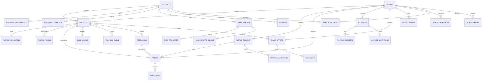

# 06. Game Data Model

**Status:** Draft for technical review
**Date:** 2026-10-23
**Depends on:** `01-requirements.md`, `02-game-design.md`, `03-gameplay-rules.md`, `04-technology-decisions.md`, `05-architecture.md`, `specs/09-v1-design-lock.md`
**Deliverables:** this document, `plan/schemas/domain.ts`, `plan/schemas/game.schema.sql`
**Scope:** v1 entities, relationships, ids, required fields, constraints, ownership, visibility, and persistence mapping.

---

## 1. Purpose and authority

### 1.1 What this document decides

This document is the canonical entity map for v1. It answers four questions:

1. **What exists?** Accounts, worlds, factions, regions, armies, alliances, trades, queues, support, rebellions, pass progress, entitlements, season results, and the supporting logs.
2. **What is authoritative?** The live world room for active simulation; the snapshot plus ordered input log for recovery; account tables and RevenueCat events for purchases; static config for immutable content.
3. **Who owns each field?** The server, the room, the database, the client, Supabase Auth, RevenueCat, or static config.
4. **Who may see it?** Public, owner, ally, battle participant, account owner, or admin.

It also defines the target physical schema in `plan/schemas/game.schema.sql` and the target domain types in `plan/schemas/domain.ts`. Those files are planning artifacts. They are not wired into a build yet.

### 1.2 Precedence

When documents disagree, resolve in this order:

1. `specs/09-v1-design-lock.md` for v1 scope and `LOCKED` rules.
2. `plan/03-gameplay-rules.md` for state transitions, guards, and field rules.
3. `plan/01-requirements.md` and `plan/02-game-design.md` for requirements and design intent.
4. `plan/04-technology-decisions.md` and `plan/05-architecture.md` for runtime, persistence, and technology.
5. This document for physical data representation.

This document may refine representation without changing gameplay. For example, it stores province troops as armies in garrison state instead of duplicating a `world_regions.troops` column. That is a data-model refinement, not a rules change.

**Support visibility is resolved.** `09` §8.1 says the national support meter is visible on the map at all times. `05` §6.8 previously treated exact support as owner-private. The authoritative spec wins: support is **public exact** in v1. `05` and `03` §17.4 have been corrected to match. This document models support as a public field.

### 1.3 Status tags

`03` and `09` use `LOCKED`, `DEFAULT`, `PROPOSED`, and `TBD`. This document uses `MODEL` for a storage/representation decision that is not a gameplay rule.

- No implementation may start from a `PROPOSED` or `TBD` line.
- A `MODEL` decision may be implemented if it does not contradict a `LOCKED` rule.
- If a balance number is unknown, the schema stores the field and config supplies the value. The schema must not invent a balance number.

### 1.4 Non-goals

This document does not define:

- exact combat, support, trade, pass, or economy balance values;
- the final shop catalog, prices, mission list, or pass reward list;
- REST or WebSocket request/response schemas;
- UI layouts or map artwork;
- migration history or deployment steps;
- legal retention or deletion policy.

Those live in `03`, `09`, static config, `05`, and the relevant product/legal decisions.

---

## 2. The four data planes

V1 has four planes. Mixing them is the most likely source of state bugs.

| Plane | Lives in | Authority | Examples | Rebuildable |
|---|---|---|---|---|
| **Static config** | Git, bundled assets, seeded catalog | Config version referenced by the world | Map geometry, unit stats, tech tree, mission definitions, cosmetic catalog | Yes, from the pinned version |
| **Live simulation** | One world room's memory | The room, single-writer | Current resources, armies, support, queues, alliances | Yes, from snapshot plus inputs |
| **Durable game record** | Postgres | Snapshot plus ordered input log | `world_snapshots`, `world_events`, `command_receipts`, projections, `battle_log`, `trade_log` | Yes for state; logs are audit |
| **Account and commerce** | Postgres, Supabase Auth, RevenueCat | Account tables and provider events | `accounts`, entitlements, pass periods, cosmetics, `season_results` | Restore from provider plus audit |

### 2.1 Authority rules

- **Live world:** the room is authoritative. A client never writes game state directly.
- **Recovery:** the latest valid snapshot plus `world_events` after `snapshot.last_event_seq` is authoritative. Projections are accelerators, not authority.
- **Account state:** `accounts`, `account_entitlements`, `pass_periods`, `pass_progress`, `missions`, and `season_results` are authoritative for their domains.
- **Purchases:** `revenuecat_events` is the idempotent provider audit; `account_entitlements` is the current grant. No client `customerInfo` is authority.
- **Frozen content:** a world pins `map_id` and `config_version`. A config change never rewrites a running world.
- **Projections:** `factions`, `world_regions`, `armies`, `trade_offers`, and queues are read models. They may lag by one committed snapshot. Never write gameplay through them.

### 2.2 Projection rules

- Projection writes happen in the same transaction as the snapshot that produced them.
- The room's `world.version`, `world.last_tick`, and `world.last_event_seq` are the checkpoint. If projections disagree with a rebuilt snapshot, the snapshot wins.
- `province_garrison` is a derived view, not an independent table. Summing a garrison from armies avoids two sources of truth.
- `battle_log`, `trade_log`, and `season_results` are durable outcomes. They are not used as live simulation inputs.
- A projection rebuild must be possible from a snapshot plus events. It must never need a client cache.

---

## 3. Mapping generic RPG terms to this game

V1 is a strategy game, not an RPG. Several requested generic concepts have no standalone entity. They are represented by configuration or by an existing aggregate.

| Generic concept | V1 representation | Why there is no separate entity |
|---|---|---|
| **Player** | `accounts` for identity and account state; `factions` for the per-world power | One person can have one faction per world. The account survives season resets; the faction does not. |
| **Enemy** | A `factions` row whose current relationship is hostile; AI warlords are `factions.kind = 'ai'`; rebels are a `rebellions` controller | "Enemy" is a temporary relationship, not an object. Hostility changes with alliance, war phase, and cooldowns. |
| **Item** | Five `resource_type` stockpiles, four `unit_type` counts, `ability_type`, and `shop_items` cosmetics | V1 has no bag, stacks, rarity rolls, crafting materials, or loot boxes. See `03` §9.1. |
| **Weapon** | National `doctrine_weapon` plus static `WeaponDefinition` counter data | Weapons are a national doctrine, not per-unit equipment. There is no inventory and no equipment slot. |
| **Skill** | National `doctrine_skill` plus static `SkillDefinition`; abilities are `AbilityDefinition` | There is no skill tree, skill points, or per-unit skill loadout. Research unlocks tools; doctrine is a national choice. |
| **Map** | Static `MapDefinition` and `MapProvince`; per-world state in `world_regions` | Geometry, adjacency, mask colours, and names are immutable content. Only ownership, level, capital, and controller change per world. |
| **Quest** | `missions` for optional pass objectives; the first-session tutorial is a client overlay | V1 has no quest log, campaign, NPC quest giver, or quest reward chain. The map is the tutorial. |
| **Inventory** | `faction_resources`, `armies` plus `army_units`, `account_entitlements`, and `account_cosmetics` | There is no player bag. Resources are fungible stockpiles; units live in armies; cosmetics are account entitlements. |
| **Progression** | `factions.era`, `faction_techs`, `world_regions.level`, `pass_progress`, `season_results` | Progression is split by scope: world power resets; account pass and cosmetics persist. There is no account level. |
| **World state** | `worlds`, the `WorldState` snapshot, `world_events`, and normalized projections | Live state is a deterministic simulation; durable state is the snapshot plus input log. |

### 3.1 Absent concepts

The following are explicitly absent from v1 and must not appear in the schema:

- player equipment, item durability, crafting materials, loot boxes, or randomized item rolls;
- per-unit weapons, per-unit skills, or skill points;
- a quest log, campaign chapters, NPC dialogue, or quest rewards;
- a player inventory or bag UI;
- chat, direct messages, emotes, pings, or taunts;
- user-uploaded images;
- email OTP, app-level email login, or email reminders;
- web checkout, Stripe, or web purchases;
- pay-to-win stat purchases;
- gamepad support.

### 3.2 Enemy is a relationship

`Enemy` is computed from state, not stored:

```
hostile(attacker, defender, at) =
  attacker != defender
  and defender is not self
  and no active protection
  and war phase allows the attack
  and alliance rules allow the attack
  and ex-ally cooldown has expired
  and target is not an ally
```

The result is used by the command validator and the battle resolver. It is not a row. `battle_log` records the parties and the result at resolution time, which is the durable historical answer.

---

## 4. Identity, time, and numeric conventions

### 4.1 Id policy

| Id | Type | Allocation | Ordering / notes |
|---|---|---|---|
| `account_id` | `uuid` | Supabase Auth | Immutable. Never reuse. No email in app tables. |
| `world_id` | `uuid` | Server at world creation | Stable for the season and archive. |
| `faction_id` | `bigint` | Per-world monotonic counter | Spawn order. Used only as the final deterministic tie-break after join time and troops. |
| `province_id` | `smallint` | Static map data | 1-254; 0 reserved for "no province". Matches the mask colour id. |
| `army_id` | `bigint` | Per-world monotonic counter | Simultaneous arrivals are ordered by army id ascending. Never reused. |
| `battle_id` | `bigint` | Per-world monotonic counter | Assigned at resolution. |
| `trade_offer_id` | `bigint` | Per-world monotonic counter | Market and direct offers share the sequence. |
| `trade_id` | `bigint` | Per-world monotonic counter | `trade_log` audit id. |
| `alliance_id` | `bigint` | Per-world monotonic counter | |
| `alliance_membership_id` | `bigint` | Per-world monotonic counter | |
| `alliance_invitation_id` | `bigint` | Per-world monotonic counter | |
| `build_order_id` | `bigint` | Per-world monotonic counter | |
| `training_order_id` | `bigint` | Per-world monotonic counter | |
| `rebellion_id` | `bigint` | Per-world monotonic counter | |
| `doctrine_change_id` | `bigint` | Per-world monotonic counter | Audit ordering only. |
| `command_id` | `uuid` | Client | Unique per account, not per world. Idempotency key. |
| `event_seq` | `bigint` | Per-world monotonic counter | `world_events.seq`; ordered input log. |
| `snapshot_seq` | `bigint` | Per-world monotonic counter | `world_snapshots.seq`. |
| `lease_version` | `bigint` | DB lease acquisition | Fencing token; increments on every acquisition. |
| `entitlement_id` | `uuid` | Server/DB | Provider event or manual grant. |
| `pass_period_id` | `uuid` | Server/DB | One pass term. |
| `revenuecat_event_id` | `text` | RevenueCat | Provider event id; primary key. |

**Why per-world bigints and not UUIDs for simulation entities:** replay must be deterministic. A database sequence or UUID generator inside a tick introduces ordering that a snapshot plus input log cannot reconstruct. The room allocates ids from `WorldState.nextIds`; the allocation is part of the committed state. UUIDs remain appropriate for account-scoped and external-provider entities.

**Composite keys:** every world-scoped table uses `(world_id, entity_id)` as the primary key and includes `world_id` in every foreign key. This makes cross-world references structurally difficult and makes archival by world straightforward.

**Province ids:** the static map owns the id space. A province id must exist in the pinned map and must have a mask colour. Region ownership is per-world; the province row is not copied into the DB.

### 4.2 Time

- All durable timestamps are `timestamptz` in UTC.
- The server clock is authoritative. Client clocks are display-only.
- `worlds.started_at` is `T0`. The day index, peace/war phase, war window, era calendar, and season freeze are derived from `T0` and the pinned config.
- The world clock is part of `WorldState.clock` and is recomputed on load and on every tick.
- `worlds.season_end` is `T0 + 30 days` for a normal v1 season. It is stored for query/read models but the room derives the phase from `T0` and config.
- No `war_window_start` column exists. Storing it would create two clocks. `war_window_start` is a derived display value.
- `effective_at` on `world_events` is the receipt/commit time in v1. Future-dated inputs are not supported.

### 4.3 Numeric rules

| Value | Storage | Rule |
|---|---|---|
| Resource amount | `bigint` | Non-negative integer. Never below zero. |
| Resource remainder | `numeric(18,6)` | `[0, 1)`; continuous production uses fixed-point, not floats. |
| Support | `smallint` | 0-100; integer display. |
| Support remainder | `numeric(18,6)` | `[0, 1)`; continuous drivers use fixed-point. |
| Unit count | `bigint` | Non-negative integer. Zero-count unit rows are deleted, not kept. |
| Combat power | `numeric(18,6)` | Unrounded comparison; display may round. |
| Loss distribution | JSONB integer vectors | Largest-remainder method; sum equals required total; no type negative. |
| Money/gold | `bigint` | Integer; gold is the trade currency; money is not transferable. |
| Score | `bigint` | Final score components are integers after config scaling. |

### 4.4 JSON rules

JSONB is allowed for:

- battle force/loss snapshots and multiplier breakdowns;
- loot/support-change audit;
- season recap;
- RevenueCat provider payloads;
- AI decision state;
- event payloads;
- account metadata.

JSONB is not the authority for:

- resources;
- unit counts;
- support;
- queue state;
- alliance membership;
- trade escrow;
- entitlements.

Those are normalized columns or tables. Every JSONB payload is validated by a Zod schema before write. `world_events.payload` and `command_receipts.result_payload` must be JSON objects, not arrays or scalars.

---

## 5. Entity map

### 5.1 Relationship diagram



### 5.2 Aggregate catalog

| Aggregate | Entities | Authority | Primary key |
|---|---|---|---|
| Account | `accounts`, `account_entitlements`, `account_cosmetics` | App server plus provider events | `account_id` |
| Pass | `pass_periods`, `pass_progress`, `pass_reward_claims`, `missions` | App server | `pass_period_id` or account plus mission |
| Commerce | `shop_items`, `revenuecat_events` | Static catalog plus webhook | `item_id` or `event_id` |
| Season | `season_results` | App server at freeze | `(world_id, faction_id)` |
| World | `worlds`, `world_leases` | App server plus room | `world_id` |
| Persistence | `world_snapshots`, `world_events`, `command_receipts` | Room plus DB | `(world_id, seq)` or account plus command |
| Faction | `factions`, `faction_resources`, `faction_techs`, `doctrine_log` | Room | `(world_id, faction_id)` |
| Support | `rebellions`, `support_daily` | Room | `(world_id, rebellion_id)` or daily composite |
| Map | static `MapDefinition` plus `world_regions`, `neutral_garrisons` | Map config plus room | `(world_id, province_id)` |
| Military | `armies`, `army_units`, `battle_log` | Room plus audit | `(world_id, army_id)` or battle |
| Social | `alliances`, `alliance_members`, `alliance_invitations` | Room | `(world_id, alliance_id)` |
| Economy | `trade_offers`, `trade_log`, `trade_daily` | Room plus audit | `(world_id, offer_id)` or trade |
| Queues | `build_queue`, `training_queue` | Room | `(world_id, order_id)` |
| Cooldowns | `ability_cooldowns`, `ex_ally_cooldowns` | Room | composite |
| Admin | `admin_audit`, `name_reports` | App server | identity or report id |

---

## 6. Account and meta-state

In the field tables below, `Req` is **Y** for required, **N** for nullable, and **C** for conditional; the condition is stated in the constraint column. `PK` and `FK` are marked in the same column.

### 6.1 `accounts`

**Ownership:** the app server owns the profile; Supabase Auth owns the credential and provider identity. The account is the durable identity across season resets.

| Field | Type | Req | Constraint / meaning |
|---|---|---|---|
| `account_id` | `uuid` | Y | PK. Supabase Auth user id. Immutable. |
| `display_name` | `text` | Y | 1-32 characters; profanity/normalization policy. Not an identity key. |
| `display_name_key` | `text` | Y | Lower-cased normalized lookup. Indexed. |
| `status` | `account_status` | Y | `active`, `banned`, `disabled`, `merged`. |
| `is_guest` | `boolean` | Y | Cached from the Supabase anonymous identity; auth remains authority. |
| `merged_into` | `uuid` | N | Self-FK to the survivor. Must not equal `account_id`. Non-null iff status is `merged`. |
| `created_at` | `timestamptz` | Y | |
| `updated_at` | `timestamptz` | Y | |
| `last_seen_at` | `timestamptz` | N | |
| `banned_until` | `timestamptz` | N | Required while status is `banned`. |
| `ban_reason` | `text` | N | Admin-facing. |
| `version` | `bigint` | Y | Optimistic concurrency for account writes. |

**Rules**

- There is **no `email` column**. Provider email may exist in Supabase Auth; it is never copied into `game.accounts`. Email OTP, email login, and email reminders are out of v1 (SD-04).
- Guest identity is the Supabase anonymous session, not a custom token table.
- Guest-to-social link keeps the existing social account when both sides have a faction in the same world. The conflicting guest faction is abandoned only after explicit confirmation. `merged_into` records the survivor.
- A merge does **not** reassign the conflicting guest faction to the survivor. It keeps its original (now merged) `account_id` and is marked abandoned; the room resolves the survivor through `accounts.merged_into`. Reassigning it would violate the one-faction-per-account-per-world index. If the survivor has no faction in that world, the guest faction may be reassigned instead.
- Account deletion and hard-erasure policy remain TBD. The schema supports `disabled` and `merged` without deleting history.

### 6.2 `account_entitlements`

**Ownership:** the app server, driven by RevenueCat webhooks, season awards, admin grants, or approved promos. The client cannot create an entitlement.

| Field | Type | Req | Constraint / meaning |
|---|---|---|---|
| `entitlement_id` | `uuid` | Y | PK; default generated. |
| `account_id` | `uuid` | Y | FK to `accounts`. |
| `kind` | `entitlement_kind` | Y | `pass`, `cosmetic`, `title`, `badge`. |
| `catalog_id` | `text` | Y | `shop_items.item_id`, `season_pass`, or a config title/badge id. |
| `source` | `entitlement_source` | Y | `revenuecat`, `season_award`, `admin_grant`, `promo`. |
| `source_event_id` | `text` | C | Required for `revenuecat`; provider event id. Unique with account plus catalog. |
| `granted_at` | `timestamptz` | Y | |
| `expires_at` | `timestamptz` | C | Required for pass; must be after `granted_at`. Cosmetics/titles are permanent unless explicitly timed. |
| `status` | `entitlement_status` | Y | `active`, `expired`, `revoked`. |
| `revoked_at` | `timestamptz` | C | Required iff revoked. |
| `revocation_reason` | `text` | N | Refund, chargeback, admin action. |
| `metadata` | `jsonb` | Y | Minimal provider/product context; no secrets. |

**Rules**

- One active cosmetic grant per account and catalog id. A refund/chargeback revokes it and removes the equipped cosmetic.
- Pass grants create one `pass_periods` row per entitlement. The current pass is the active period with the latest `ends_at`.
- An entitlement never grants combat power, resources, units, or support. Cosmetics only, plus the pass track; no pay-to-win.
- The web shop is browsable but read-only. Purchases happen through mobile IAP and RevenueCat. No Stripe or web checkout.

### 6.3 `account_cosmetics`

| Field | Type | Req | Constraint / meaning |
|---|---|---|---|
| `account_id` | `uuid` | Y | FK to `accounts`; part of PK. |
| `slot` | `cosmetic_slot` | Y | Part of PK. One equipped item per slot. |
| `catalog_id` | `text` | Y | Must be an active owned cosmetic. |
| `equipped_at` | `timestamptz` | Y | |

Ownership is checked against `account_entitlements`. Equipping a cosmetic that changes world-visible appearance is recorded as an `account` world event and may force a snapshot. Cosmetics never change stats.

### 6.4 Pass periods, progress, rewards, and missions

A pass is account-wide, rolling 30 days from purchase, and may cross a season boundary. Season power still resets.

**`pass_periods`**

| Field | Type | Req | Constraint / meaning |
|---|---|---|---|
| `pass_period_id` | `uuid` | Y | PK. |
| `account_id` | `uuid` | Y | FK to `accounts`. |
| `starts_at` | `timestamptz` | Y | Purchase/grant time. |
| `ends_at` | `timestamptz` | Y | `starts_at + configured term` (30 days default). Must be after start. |
| `source_entitlement_id` | `uuid` | Y | Unique FK to the pass entitlement. |
| `status` | `pass_period_status` | Y | `active`, `expired`, `revoked`. |
| `created_at` | `timestamptz` | Y | |

**`pass_progress`**

| Field | Type | Req | Constraint / meaning |
|---|---|---|---|
| `pass_period_id` | `uuid` | Y | PK; one row per period. |
| `xp` | `bigint` | Y | Non-negative. |
| `level` | `integer` | Y | Non-negative; exact ladder is config/TBD. |
| `premium_unlocked` | `boolean` | Y | Cached from the pass entitlement. |
| `updated_at` | `timestamptz` | Y | |

**`pass_reward_claims`**

| Field | Type | Req | Constraint / meaning |
|---|---|---|---|
| `pass_period_id` | `uuid` | Y | Part of PK. |
| `reward_id` | `text` | Y | Part of PK; must exist in the pinned reward config. |
| `state` | `pass_reward_state` | Y | `locked`, `claimable`, `claimed`, `auto_claimed`. |
| `claimed_at` | `timestamptz` | C | Required for claimed states. |
| `updated_at` | `timestamptz` | Y | |

**`missions`**

| Field | Type | Req | Constraint / meaning |
|---|---|---|---|
| `account_id` | `uuid` | Y | FK; part of PK. |
| `mission_id` | `text` | Y | Part of PK; static config id. |
| `period_key` | `text` | Y | Part of PK; e.g. `daily:2026-10-23` or `weekly:2026-W43`. Exact cadence is TBD. |
| `progress` | `integer` | Y | Non-negative. |
| `target` | `integer` | Y | Positive; copied from config at creation. |
| `state` | `mission_state` | Y | `active`, `completed`, `claimed`, `expired`. |
| `completed_at` | `timestamptz` | C | Required for completed/claimed. |
| `claimed_at` | `timestamptz` | C | Required for claimed. |
| `updated_at` | `timestamptz` | Y | |

There is no campaign quest log. `missions` exists only for optional pass objectives. The first-session tutorial is a client overlay and is not server-persisted in v1.

### 6.5 Season results

**Ownership:** app server at season freeze. A result is written once, after the final snapshot, and is not mutable by players.

| Field | Type | Req | Constraint / meaning |
|---|---|---|---|
| `world_id` | `uuid` | Y | Part of PK; FK to `worlds`. |
| `faction_id` | `bigint` | Y | Part of PK; FK to `factions`. |
| `account_id` | `uuid` | N | Null for AI. One player faction per world; unique when non-null. |
| `rank` | `smallint` | Y | `>= 1`. |
| `province_count` | `smallint` | Y | Non-negative. |
| `total_troops` | `bigint` | Y | Non-negative. |
| `economy_score` | `bigint` | Y | Non-negative. |
| `army_score` | `bigint` | Y | Non-negative. |
| `support_score` | `bigint` | Y | Non-negative. |
| `total_score` | `bigint` | Y | Non-negative. |
| `is_player_controlled` | `boolean` | Y | False for AI and abandoned/AI-controlled factions. Awards require true. |
| `is_linked` | `boolean` | Y | Linked Google/Apple identity at freeze. Awards require true. |
| `is_conqueror` | `boolean` | Y | At most one per world. |
| `is_best_nation` | `boolean` | Y | At most one per world. |
| `title_ids` | `text[]` | Y | A faction may win both titles; empty for non-winners. |
| `recap` | `jsonb` | Y | Minimal recap; no secrets. |
| `final_snapshot_seq` | `bigint` | Y | FK to the final snapshot. |
| `created_at` | `timestamptz` | Y | |

**Rules**

- Partial unique indexes enforce at most one Conqueror and one Best Nation per world.
- AI factions are not eligible for either title. `is_player_controlled` is false for them.
- A title requires `is_player_controlled` and `is_linked` at freeze; the DB check rejects an award for an ineligible row.
- Score components and scaling are config/TBD; the columns exist so the result is auditable without rerunning the season.
- A faction can win both titles; `title_ids` stores both.

### 6.6 Shop catalog and RevenueCat events

**`shop_items`** is a static/seed catalog, not per-player data.

| Field | Type | Req | Constraint / meaning |
|---|---|---|---|
| `item_id` | `text` | Y | PK; stable config id. |
| `kind` | `shop_item_kind` | Y | `pass` or `cosmetic`. |
| `slot` | `cosmetic_slot` | C | Required for cosmetic; null for pass. |
| `name` | `text` | Y | Display name. |
| `description` | `text` | Y | Display text; default empty. |
| `price_usd_cents` | `integer` | Y | Display only; non-negative. Mobile store price is authoritative. |
| `store_product_id` | `text` | N | App Store/Play product id; unique when present. |
| `active` | `boolean` | Y | |
| `metadata` | `jsonb` | Y | Asset keys, tags, restrictions. |
| `created_at`, `updated_at` | `timestamptz` | Y | |

**`revenuecat_events`**

| Field | Type | Req | Constraint / meaning |
|---|---|---|---|
| `event_id` | `text` | Y | PK; provider event id. Replay is a no-op. |
| `account_id` | `uuid` | N | Null if the provider app user cannot be mapped. |
| `app_user_id` | `text` | Y | Provider's app user id; expected to be the account UUID. |
| `event_type` | `text` | Y | Provider event type. |
| `product_id` | `text` | N | Store product id. |
| `entitlement_ids` | `text[]` | Y | Provider entitlement ids. |
| `event_at` | `timestamptz` | Y | |
| `payload` | `jsonb` | Y | Minimal provider payload; no secrets. |
| `status` | `revenuecat_status` | Y | `received`, `processed`, `ignored`, `failed`. |
| `processed_at` | `timestamptz` | C | Required for processed/ignored. |
| `error` | `text` | N | Failure detail. |

The webhook is authenticated and idempotent. It grants or revokes entitlements; it never writes world state directly. A refund revokes the entitlement and removes the equipped cosmetic. Restore uses the server-side RevenueCat lookup, not client `customerInfo`.

---

## 7. World and persistence

### 7.1 `worlds`

| Field | Type | Req | Constraint / meaning |
|---|---|---|---|
| `world_id` | `uuid` | Y | PK. |
| `name` | `text` | Y | Display name. |
| `map_id` | `text` | Y | Pinned static map. |
| `config_version` | `text` | Y | Pinned balance/config version. |
| `status` | `world_status` | Y | `creating`, `open`, `running`, `finished`. |
| `operational_state` | `operational_state` | N | `paused`, `quarantined`, `archived`; overlay, not a public lifecycle state. |
| `started_at` | `timestamptz` | C | `T0`; required once open/running/finished. |
| `join_deadline` | `timestamptz` | N | Must be after start if present. |
| `season_end` | `timestamptz` | N | Must be after start; normal v1 is `T0 + 30 days`. |
| `max_humans` | `smallint` | Y | 20-24. |
| `ai_count` | `smallint` | Y | 10-15 AI warlords. |
| `province_count` | `smallint` | Y | 80-100 for v1. |
| `version` | `bigint` | Y | Applied-input version for stale-command checks. |
| `last_tick` | `bigint` | Y | Last applied simulation tick. |
| `last_event_seq` | `bigint` | Y | Last committed input sequence. |
| `final_snapshot_seq` | `bigint` | C | Required when status is finished; FK to `world_snapshots`. |
| `created_at` | `timestamptz` | Y | |
| `finished_at` | `timestamptz` | C | Required when status is finished. |

`war_window_start`, `day_index`, and `phase` are not columns. They are derived from `started_at` and the pinned config. This preserves one clock.

### 7.2 `world_leases`

| Field | Type | Req | Constraint / meaning |
|---|---|---|---|
| `world_id` | `uuid` | Y | PK; FK to `worlds`. |
| `owner_id` | `text` | Y | Process/instance identity. |
| `lease_version` | `bigint` | Y | Fencing token; increments on acquisition. |
| `lease_expires_at` | `timestamptz` | Y | Must be after acquisition. |
| `heartbeat_at` | `timestamptz` | Y | Renewal time. |
| `acquired_at` | `timestamptz` | Y | |

Every snapshot/event write includes `lease_version`. A stale writer's transaction must fail. This prevents two rooms from writing the same world after a partition.

### 7.3 `world_snapshots`

| Field | Type | Req | Constraint / meaning |
|---|---|---|---|
| `world_id` | `uuid` | Y | Part of PK. |
| `seq` | `bigint` | Y | Part of PK; per-world snapshot sequence. |
| `tick` | `bigint` | Y | Non-negative; simulation tick represented. |
| `effective_at` | `timestamptz` | Y | State time. |
| `state_gzip` | `bytea` | Y | Gzip-compressed canonical JSON `WorldState`. Non-empty. |
| `state_hash` | `bytea` | Y | SHA-256 of canonical uncompressed JSON; 32 bytes. |
| `last_event_seq` | `bigint` | Y | Last event included. |
| `config_version` | `text` | Y | Must match the world. |
| `lease_version` | `bigint` | Y | Writer fence. |
| `created_at` | `timestamptz` | Y | |

The snapshot is an accelerator. A command is never acknowledged because a snapshot exists; the command is acknowledged when its input and receipt are durable. Snapshots are written every 60 seconds and on key events.

### 7.4 `world_events`

| Field | Type | Req | Constraint / meaning |
|---|---|---|---|
| `world_id` | `uuid` | Y | Part of PK. |
| `seq` | `bigint` | Y | Part of PK; monotonic per world. |
| `type` | `world_event_type` | Y | `join`, `command`, `admin`, `season`, `system`, `account`. |
| `command_type` | `text` | N | Mirrors the command enum or names an audit event such as `ai_decision`. |
| `actor_type` | `event_actor_type` | Y | `account`, `faction`, `admin`, `system`. |
| `actor_account_id` | `uuid` | N | Account actor; FK to `accounts`. |
| `actor_faction_id` | `bigint` | N | Faction actor; composite FK. |
| `command_id` | `uuid` | N | Client idempotency key when applicable. |
| `effective_at` | `timestamptz` | Y | Receipt time in v1. |
| `priority` | `smallint` | Y | 0-80; lower runs first. |
| `payload` | `jsonb` | Y | Validated input/command object or audit payload. |
| `lease_version` | `bigint` | Y | Writer fence. |
| `created_at` | `timestamptz` | Y | |

Order is `(effective_at, priority, seq)`. Events are committed inputs or audit records, not per-tick outcomes. Simulation replay applies only committed input events; audit-only `system`, `admin`, and `account` rows are skipped. This is what makes deterministic replay possible.

### 7.5 `command_receipts`

| Field | Type | Req | Constraint / meaning |
|---|---|---|---|
| `account_id` | `uuid` | Y | Part of PK. |
| `command_id` | `uuid` | Y | Part of PK; client-generated. |
| `world_id` | `uuid` | Y | FK. |
| `faction_id` | `bigint` | N | FK when the command acts as a faction. |
| `command_type` | `text` | Y | Validated command type. |
| `result_code` | `text` | Y | Stable result code. |
| `result_payload` | `jsonb` | Y | Original response object. |
| `created_at` | `timestamptz` | Y | |
| `expires_at` | `timestamptz` | Y | Must be after creation. |

The input event and receipt are written in one transaction. A duplicate command id returns the stored result and never re-applies. Receipts are retained for the season plus a safety window.

---

## 8. Faction, economy, support, and rebellion

### 8.1 `factions`

**Ownership:** the world room. The table is a projection; the snapshot is authority.

| Field | Type | Req | Constraint / meaning |
|---|---|---|---|
| `world_id` | `uuid` | Y | Part of PK. |
| `faction_id` | `bigint` | Y | Part of PK; per-world monotonic. |
| `account_id` | `uuid` | N | Null only for AI. One account per world. |
| `kind` | `faction_kind` | Y | `player` or `ai`. |
| `state` | `faction_state` | Y | `pending_spawn`, `active`, `eliminated`, `spectator`, `ai_controlled`, `finished`. |
| `name` | `text` | Y | 1-32 characters. |
| `name_key` | `text` | Y | Normalized lookup/moderation. |
| `emblem_id` | `text` | Y | Curated emblem; no uploads. |
| `color_id` | `text` | Y | Map colour. |
| `capital_province_id` | `smallint` | N | Must be owned by the faction when active; null for AI warlords. Deferrable FK. |
| `support` | `smallint` | Y | 0-100; public exact. |
| `support_remainder` | `numeric(18,6)` | Y | `[0,1)`. |
| `rebellion_state` | `rebellion_faction_state` | Y | `none`, `active`, `grace`. |
| `rebellion_grace_until` | `timestamptz` | C | Required when state is `grace`. |
| `protection_until` | `timestamptz` | N | Faction protection; never province-scoped. |
| `era` | `smallint` | Y | 1-4; cached from the clock. |
| `voluntary_relocation_used` | `boolean` | Y | Set by the once-per-season voluntary capital relocation; reset at season start. |
| `build_slots` | `smallint` | Y | 1-2; national build queue capacity. |
| `training_slots` | `smallint` | Y | 1-2; national training queue capacity. |
| `doctrine_weapon` | `doctrine_weapon` | N | National choice. |
| `doctrine_skill` | `doctrine_skill` | N | National choice. |
| `ai_archetype` | `ai_archetype` | C | Required for AI factions and AI-controlled abandoned players; null otherwise. |
| `ai_state` | `jsonb` | N | Private decision state; validated object. |
| `public_score` | `bigint` | Y | Non-negative; map leaderboard projection. |
| `joined_at` | `timestamptz` | Y | Tie-break input. |
| `last_seen_at` | `timestamptz` | N | Abandonment input. |
| `abandoned_at` | `timestamptz` | N | |
| `eliminated_at` | `timestamptz` | N | |
| `finished_at` | `timestamptz` | N | |
| `created_at`, `updated_at` | `timestamptz` | Y | |

**Rules**

- A player account has at most one faction per world. An AI faction has no account.
- A player faction has at most one capital. The capital flag and `capital_province_id` must agree; the room moves both in one transaction. AI warlords have no capital flag and a null `capital_province_id`.
- `voluntary_relocation_used` is set only by the once-per-season voluntary relocation; capture-triggered relocation never sets it. It resets at season start with the faction row.
- Faction support is public. It is not part of private state and never modifies combat power.
- `ai_controlled` is a state for an abandoned player faction; `kind` remains `player`, the account stays linked, and the faction carries an `ai_archetype`/`ai_state` for takeover.
- `spectator` keeps account identity but has no map power.
- AI warlords are factions, not a separate enemy table. Rebels are **not** factions; they are `rebellions` rows plus rebel-owned armies.

### 8.2 `faction_resources`

| Field | Type | Req | Constraint / meaning |
|---|---|---|---|
| `world_id` | `uuid` | Y | Part of PK. |
| `faction_id` | `bigint` | Y | Part of PK. |
| `resource_type` | `resource_type` | Y | `money`, `gold`, `food`, `water`, `oil`. |
| `amount` | `bigint` | Y | Non-negative. |
| `remainder` | `numeric(18,6)` | Y | `[0,1)`. |
| `updated_at` | `timestamptz` | Y | |

Exactly five rows are created per faction. Storage caps are derived from config/province levels and are not stored separately. Resource production is fixed-point; the remainder prevents repeated-rounding loss.

### 8.3 Research and doctrine

**`faction_techs`**

| Field | Type | Req | Constraint / meaning |
|---|---|---|---|
| `world_id` | `uuid` | Y | Part of PK. |
| `faction_id` | `bigint` | Y | Part of PK. |
| `tech_id` | `text` | Y | Part of PK; static config id. |
| `purchased_at` | `timestamptz` | Y | |

**`doctrine_log`**

| Field | Type | Req | Constraint / meaning |
|---|---|---|---|
| `world_id` | `uuid` | Y | Part of PK. |
| `change_id` | `bigint` | Y | Part of PK. |
| `faction_id` | `bigint` | Y | FK. |
| `old_weapon`, `new_weapon` | `doctrine_weapon` | N | |
| `old_skill`, `new_skill` | `doctrine_skill` | N | |
| `changed_at` | `timestamptz` | Y | |

Current doctrine is on `factions`; the log is the audit. Doctrine changes are peace-only, paid, and limited to the approved rules. There is no per-unit equipment.

### 8.4 Support and rebellion

**`support_daily`**

| Field | Type | Req | Constraint / meaning |
|---|---|---|---|
| `world_id` | `uuid` | Y | Part of PK. |
| `faction_id` | `bigint` | Y | Part of PK. |
| `province_id` | `smallint` | Y | Part of PK. |
| `world_day` | `smallint` | Y | 1-30. |
| `net_delta` | `numeric(8,3)` | Y | Regional-event total applied today. |
| `updated_at` | `timestamptz` | Y | |

The ±1 net per province per day cap is a `PROPOSED` rules check (`03` §13.3), enforced by the room and tests, not by a hard DB range. Continuous drivers and one-time events are not regional-event rows.

**`rebellions`**

| Field | Type | Req | Constraint / meaning |
|---|---|---|---|
| `world_id` | `uuid` | Y | Part of PK. |
| `rebellion_id` | `bigint` | Y | Part of PK. |
| `origin_faction_id` | `bigint` | Y | FK; the faction whose support spawned the rebels. |
| `province_id` | `smallint` | Y | Deferrable FK to `world_regions`; rebel-held province. |
| `state` | `rebellion_state` | Y | `spawned`, `holding`, `defeated`. |
| `spawned_at` | `timestamptz` | Y | |
| `defeated_at` | `timestamptz` | C | Required when defeated. |

A faction has at most one active rebellion. Rebels are PvE and use the same combat rules. A rebel army has `owner_faction_id = null` and `rebel_group_id` set. When a rebellion ends, the rebel province is resolved and `world_regions.rebel_group_id` is cleared.

### 8.5 Build and training queues

**`build_queue`**

| Field | Type | Req | Constraint / meaning |
|---|---|---|---|
| `world_id` | `uuid` | Y | Part of PK. |
| `order_id` | `bigint` | Y | Part of PK. |
| `faction_id` | `bigint` | Y | FK. |
| `province_id` | `smallint` | Y | FK; the province being upgraded. |
| `from_level` | `smallint` | Y | 1-4. |
| `to_level` | `smallint` | Y | Must equal `from_level + 1`; 2-5. |
| `state` | `queue_state` | Y | `queued`, `running`, `completed`, `cancelled`. |
| `enqueued_at` | `timestamptz` | Y | |
| `started_at` | `timestamptz` | C | Required when running/completed. |
| `finishes_at` | `timestamptz` | C | Required when running/completed. |
| `cost_money` | `bigint` | Y | Non-negative. |
| `cost_resource_type` | `resource_type` | N | Null when no second resource. |
| `cost_resource_amount` | `bigint` | Y | Non-negative. |
| `refund_amount` | `bigint` | Y | Non-negative; 50% is the current proposal. |
| `cancel_reason` | `text` | C | Required when cancelled. |
| `completed_at` | `timestamptz` | C | Required when completed. |

**Rules**

- One running build per faction; one active build per province. Partial unique indexes enforce both.
- Queue capacity is `factions.build_slots`: 1 by default, upgradable to 2. At most one order runs; the rest wait in `queued`.
- `cost_resource_type` is null exactly when `cost_resource_amount` is zero. The cost is deducted at enqueue; the refund is the amount actually returned.
- A province can be queued once. The next queued order starts when the running slot is free.
- A captured or eliminated province cancels its order. Refund behavior remains `PROPOSED`; the schema stores the refund actually applied.
- The first level is 1; there is no level-0 upgrade.

**`training_queue`**

| Field | Type | Req | Constraint / meaning |
|---|---|---|---|
| `world_id` | `uuid` | Y | Part of PK. |
| `order_id` | `bigint` | Y | Part of PK. |
| `faction_id` | `bigint` | Y | FK. |
| `province_id` | `smallint` | Y | FK; destination province. |
| `unit_type` | `unit_type` | Y | `tank`, `aircraft`, or `artillery`; not infantry. |
| `count` | `bigint` | Y | Positive. |
| `state` | `queue_state` | Y | Same queue states. |
| `enqueued_at` | `timestamptz` | Y | |
| `started_at` | `timestamptz` | C | Required when running/completed. |
| `finishes_at` | `timestamptz` | C | Required when running/completed. |
| `cost_money` | `bigint` | Y | Non-negative. |
| `cost_resource_type` | `resource_type` | N | |
| `cost_resource_amount` | `bigint` | Y | Non-negative. |
| `refund_amount` | `bigint` | Y | Non-negative. |
| `cancel_reason` | `text` | C | Required when cancelled. |
| `completed_at` | `timestamptz` | C | Required when completed. |

One running training order per faction; queue capacity is `factions.training_slots` (1-2). The optional second-resource cost follows the same null/zero rule as build orders. Training over the province cap loses the excess at completion; the order itself is not partially refunded. Infantry growth is automatic and is not a training order.

### 8.6 Cooldowns

**`ability_cooldowns`**

| Field | Type | Req | Constraint / meaning |
|---|---|---|---|
| `world_id` | `uuid` | Y | Part of PK. |
| `faction_id` | `bigint` | Y | Part of PK. |
| `ability` | `ability_type` | Y | Part of PK. |
| `ready_at` | `timestamptz` | Y | |
| `last_used_at` | `timestamptz` | Y | |

Cooldowns are per faction, not per province. Abilities are war-only in v1.

**`ex_ally_cooldowns`**

| Field | Type | Req | Constraint / meaning |
|---|---|---|---|
| `world_id` | `uuid` | Y | Part of PK. |
| `faction_a_id` | `bigint` | Y | Part of PK; lower id. |
| `faction_b_id` | `bigint` | Y | Part of PK; higher id. |
| `until` | `timestamptz` | Y | |
| `reason` | `leave_reason` | Y | `left` or `kicked`. |

The ordered pair is canonical: `faction_a_id < faction_b_id`. One row covers both directions.

### 8.7 AI state

`factions.ai_state` is a private JSON object. The typed shape in `domain.ts` is:

```
AiState {
  archetype,
  lastDecisionAt,
  nextDecisionAt,
  targetFactionId,
  targetProvinceId,
  stance: expand | defend | raid | recover,
  reserveRatio
}
```

It is persisted in snapshots and may be projected for admin debugging. It is never exposed in `StateView` or public Colyseus state. AI decisions are deterministic from the world seed, config, and committed state.

Each AI decision is also appended to `world_events` as a `system` event with `command_type = 'ai_decision'`; its payload carries the seed, visible inputs, chosen action, and result required by `03` section 14.2. This is audit/replay evidence, not a player command.

---

## 9. Map and province

### 9.1 Static map data

`MapDefinition` and `MapProvince` live in `packages/map-data`, not in Postgres. A world references `map_id` and `config_version`.

| `MapProvince` field | Type | Req | Constraint / meaning |
|---|---|---|---|
| `provinceId` | `smallint` | Y | 1-254; unique; matches mask colour id. |
| `name` | `text` | Y | Invented region name. |
| `terrain` | `text` | Y | Visual/narrative only; no combat modifier. |
| `terrainResource` | `resource_type` | Y | Fixed for the season; capital produces money instead. |
| `neighbors` | `province_id[]` | Y | Symmetric; no self-loop; all ids exist. |
| `maskColor` | `text` | Y | Hex colour used by the hidden mask. |
| `centroid` | `{x, y}` | Y | UI hit-testing/labels. |
| `isRefugeeCandidate` | `boolean` | Y | May be reserved as a respawn province. |

**Map constraints**

- 80-100 provinces for v1.
- Every province has at least one neighbour; the graph is connected.
- Adjacency is symmetric. A missing reverse edge is a config validation failure.
- Mask colours are unique and opaque; no anti-aliasing at province borders.
- `terrainResource` is one of the five resources. A capital's effective resource is money; that is a rules derivation, not a stored `effective_resource` column.
- The map is immutable for a world. A new map version means a new `map_id`/world.

### 9.2 `world_regions`

| Field | Type | Req | Constraint / meaning |
|---|---|---|---|
| `world_id` | `uuid` | Y | Part of PK. |
| `province_id` | `smallint` | Y | Part of PK; static map id. |
| `owner_faction_id` | `bigint` | N | Null for neutral/refugee/rebel. |
| `controller_type` | `controller_type` | Y | `none`, `player`, `ai`, `rebel`. |
| `rebel_group_id` | `bigint` | N | Set iff controller is rebel. |
| `last_attacker_faction_id` | `bigint` | N | Last player/AI faction that captured the province; null after a rebel capture. Used for respawn placement. |
| `level` | `smallint` | Y | 1-5. |
| `terrain_resource` | `resource_type` | Y | Copied from static map; fixed for the season. |
| `is_capital` | `boolean` | Y | At most one per player faction; false for AI, rebel, neutral, and refugee provinces. |
| `is_refugee` | `boolean` | Y | Unowned, level 1, reserved for respawn. |
| `captured_at` | `timestamptz` | N | |
| `updated_at` | `timestamptz` | Y | |

**Controller invariant**

```
controller_type = 'none'  -> owner is null, rebel is null
controller_type = player/ai -> owner is not null, rebel is null
controller_type = rebel   -> owner is null, rebel is not null
```

**Rules**

- Exactly one controller per province.
- The capital flag requires a player-faction owner and sets `factions.capital_province_id` in the same transaction. AI warlords never carry the flag.
- A refugee province has no owner and level 1. It becomes owned on respawn.
- Terrain resource never changes on capture. Effective resource is money while a capital; that is derived.
- **There is no stored `troops` column.** Province troops are the sum of garrison armies and `army_units`, plus `neutral_garrisons` for neutral provinces. The `province_garrison` view is the read model. This removes a second source of truth that `09` §15.4's sketch implies.
- Protection is on `factions.protection_until`, not per province. A captured/protected province uses the faction's protection window.

### 9.3 Derived garrison and neutral garrisons

`game.province_garrison` groups `armies` with `state = 'garrison'` and sums `army_units`, then adds `neutral_garrisons`. It is a read model with no independent writes. `world_regions` never stores a garrison count.

`neutral_garrisons` exists because a neutral province has no faction or rebel group and therefore cannot own an `armies` row under the one-owner invariant. It stores only neutral defenders; owned/AI/rebel garrisons remain armies. Rows are seeded at world creation, reduced by battle losses, and deleted when the province is captured. A neutral province that becomes owned with no garrison gets no rows.

The troop cap is derived from province level and config. It limits growth/training completion, not the legality of an arriving army or a capture. This matches `03` §10.2.

---

## 10. Military

### 10.1 `armies`

| Field | Type | Req | Constraint / meaning |
|---|---|---|---|
| `world_id` | `uuid` | Y | Part of PK. |
| `army_id` | `bigint` | Y | Part of PK; per-world monotonic. |
| `owner_faction_id` | `bigint` | N | Exactly one of owner/rebel is set. |
| `rebel_group_id` | `bigint` | N | Exactly one of owner/rebel is set. |
| `state` | `army_state` | Y | `garrison`, `marching`, `resolving`, `destroyed`. |
| `purpose` | `army_purpose` | C | Required while marching/resolving: attack, reinforce, transfer, return, recall_return. |
| `mode` | `movement_mode` | C | Required while marching/resolving: land, air, strategic. |
| `location_province_id` | `smallint` | C | Set only for garrison. |
| `origin_province_id` | `smallint` | C | Set only for marching/resolving. |
| `target_province_id` | `smallint` | C | Set only for marching/resolving; not equal to origin. |
| `depart_at` | `timestamptz` | C | Set only for marching/resolving. |
| `arrive_at` | `timestamptz` | C | Set only for marching/resolving; after depart. |
| `fatigue_until` | `timestamptz` | N | Per-army attack lockout. |
| `recallable` | `boolean` | Y | False for garrison. |
| `created_at` | `timestamptz` | Y | |
| `destroyed_at` | `timestamptz` | C | Required when destroyed. |

**State shape**

- `garrison`: location set; origin/target/purpose/mode/depart/arrive null.
- `marching` or `resolving`: location null; origin/target/purpose/mode/depart/arrive set.
- `destroyed`: terminal; `destroyed_at` set.

**Rules**

- An army is in exactly one place. It is never both a garrison and a march.
- `army_units` is the only unit-count authority for an army.
- A garrison army is part of the province's troops; it is not a second province count.
- Split and merge conserve units. Zero-count unit rows are deleted.
- `army_id` ascending is the deterministic final ordering for simultaneous arrivals.
- Battle fatigue locks the same army out of a new attack for 20 minutes, default.
- Rebel armies use `rebel_group_id`; player/AI armies use `owner_faction_id`. Neutral defenders are not armies; they live in `neutral_garrisons`.

### 10.2 `battle_log`

| Field | Type | Req | Constraint / meaning |
|---|---|---|---|
| `world_id` | `uuid` | Y | Part of PK. |
| `battle_id` | `bigint` | Y | Part of PK. |
| `province_id` | `smallint` | Y | FK. |
| `attacker_controller_type` | `controller_type` | Y | `player`, `ai`, or `rebel`. |
| `attacker_faction_id` | `bigint` | C | FK. Required for player/AI; null for a rebel uprising. |
| `defender_controller_type` | `controller_type` | Y | `none`, `player`, `ai`, or `rebel`. |
| `defender_faction_id` | `bigint` | C | FK. Required for player/AI; null for neutral or rebel defender. |
| `attacker_army_id` | `bigint` | Y | FK. |
| `defender_army_ids` | `bigint[]` | Y | Defending garrison/reinforcement armies; empty for neutral. |
| `started_at`, `resolved_at` | `timestamptz` | Y | Resolved >= started. |
| `result` | `battle_result` | Y | `attacker_win`, `defender_win`, `capture_no_battle`, `aborted`. |
| `province_level_before`, `province_level_after` | `smallint` | Y | 1-5. |
| `attacker_power`, `defender_power` | `numeric(18,6)` | Y | Unrounded comparison values. |
| `attacker_units`, `defender_units` | `jsonb` | Y | Exact forces at resolution. |
| `attacker_losses`, `defender_losses` | `jsonb` | Y | Integer vectors; largest-remainder sum. |
| `attacker_multipliers`, `defender_multipliers` | `jsonb` | Y | Breakdown; no hidden modifier. |
| `loot` | `jsonb` | Y | Resource loot and caps. |
| `support_changes` | `jsonb` | Y | Support events. |
| `new_owner_faction_id` | `bigint` | N | Set on capture. |
| `public_summary` | `jsonb` | Y | Safe public summary. |
| `created_at` | `timestamptz` | Y | |

**Controller shapes**

- A player/AI attacker has an `attacker_faction_id`; a rebel uprising has `attacker_controller_type = 'rebel'` and no attacker faction.
- A player/AI defender has a `defender_faction_id`; a neutral or rebel defender has none.
- A neutral defender has no faction but may have a `neutral_garrisons` row; it is valid for both `capture_no_battle` and a resolved battle.
- The attacker army is always identified by `attacker_army_id`; for a rebel uprising it is the rebel army. This keeps history valid even after the army is destroyed.

**Visibility**

- Public: battle occurred, province, parties, controller types, result, public summary.
- Involved parties after resolution: exact powers, forces, losses, multipliers.
- Never public: hidden modifiers (none exist), AI internal decision state, account details.

The exact-power tie is resolved (`03` §20.1, approved 2026-10-23): the defender wins, the attacker loses all committed units, and the defender loses 50% of committed units (DEFAULT config). The schema does not encode a winner rule; `result` and losses come from the rules engine.

### 10.3 Arrival ordering

When multiple marches arrive at the same province at the same simulation timestamp, resolve in this order:

1. `arrive_at` ascending;
2. arrival `priority` ascending;
3. `army_id` ascending;
4. `world_events.seq` ascending as the final audit tie-break.

This is the battle-resolution order, not the order in which input rows were appended. The priority is the scheduled event priority from `03` 2.6; it is not stored on the army. Replay recomputes arrivals from army state; the event log remains an input log. `army_id` is allocated at launch, so it is stable across replay. This is why army ids must not be UUIDs or DB sequences.

---

## 11. Social and economy

### 11.1 `alliances`

| Field | Type | Req | Constraint / meaning |
|---|---|---|---|
| `world_id` | `uuid` | Y | Part of PK. |
| `alliance_id` | `bigint` | Y | Part of PK. |
| `name` | `text` | Y | 1-32 characters. |
| `name_key` | `text` | Y | Normalized; unique among active alliances per world. |
| `leader_faction_id` | `bigint` | N | Null while no acting leader. |
| `state` | `alliance_state` | Y | `active`, `dissolved`. |
| `created_at` | `timestamptz` | Y | |
| `dissolved_at` | `timestamptz` | C | Required when dissolved. |

Alliances are diplomatic/economic, not military. Maximum three factions. No shared commands, stationing, joint attacks, or shared victory. Formed in peace, locked during war.

### 11.2 `alliance_members` and `alliance_invitations`

**`alliance_members`**

| Field | Type | Req | Constraint / meaning |
|---|---|---|---|
| `world_id` | `uuid` | Y | Part of PK. |
| `membership_id` | `bigint` | Y | Part of PK. |
| `alliance_id` | `bigint` | Y | FK. |
| `faction_id` | `bigint` | Y | FK. |
| `role` | `alliance_role` | Y | `leader`, `member`. |
| `joined_at` | `timestamptz` | Y | |
| `left_at` | `timestamptz` | N | Null while active. |
| `leave_reason` | `leave_reason` | C | Required when left. |

- One active membership per faction per world.
- One active leader per alliance.
- The maximum of three members is a room invariant and integration test, not a simple DB check.
- An eliminated member keeps membership and shared vision, but cannot invite, kick, or lead.
- Leaving costs support and starts the ex-ally cooldown, handled by the room.
- The join cooldown is derived from the faction's latest `left_at`; no separate `join_blocked_until` column is needed. `ex_ally_cooldowns` stores the pair attack lock.

**`alliance_invitations`**

| Field | Type | Req | Constraint / meaning |
|---|---|---|---|
| `world_id` | `uuid` | Y | Part of PK. |
| `invitation_id` | `bigint` | Y | Part of PK. |
| `alliance_id` | `bigint` | Y | FK. |
| `inviter_faction_id` | `bigint` | Y | FK. |
| `invitee_faction_id` | `bigint` | Y | FK. |
| `state` | `invitation_state` | Y | `pending`, `accepted`, `declined`, `expired`, `cancelled`. |
| `created_at` | `timestamptz` | Y | |
| `expires_at` | `timestamptz` | Y | After creation. |
| `responded_at` | `timestamptz` | C | Required when not pending. |

One pending invitation per invitee. No self-invite. Invitations are peace-only.

### 11.3 `trade_offers`, `trade_log`, and `trade_daily`

**`trade_offers`**

| Field | Type | Req | Constraint / meaning |
|---|---|---|---|
| `world_id` | `uuid` | Y | Part of PK. |
| `offer_id` | `bigint` | Y | Part of PK. |
| `kind` | `trade_kind` | Y | `market_listing` or `direct_offer`; `state_exchange` is only in the log. |
| `seller_faction_id` | `bigint` | Y | FK. |
| `buyer_faction_id` | `bigint` | C | Required for direct; null for market. Not self. |
| `resource` | `tradeable_resource` | Y | Food, water, or oil. Gold is currency; money is not tradeable. |
| `amount` | `bigint` | Y | Positive. |
| `price_gold` | `bigint` | Y | Positive. |
| `state` | `trade_offer_state` | Y | `open`, `pending`, `accepted`, `declined`, `cancelled`, `expired`. |
| `escrow_amount` | `bigint` | Y | Non-negative; equals `amount` while open/pending. |
| `tax_gold` | `bigint` | Y | Non-negative; charged to the gold receiver and burned. |
| `created_at` | `timestamptz` | Y | |
| `expires_at` | `timestamptz` | Y | After creation. |
| `frozen_at` | `timestamptz` | N | Set when war freezes the offer; state remains open/pending. |
| `resolved_at` | `timestamptz` | N | |

**Rules**

- Escrow is held while open/pending; accepting or cancelling zeroes it. There is no partial escrow.
- A market listing has no buyer; a direct offer has exactly one named buyer.
- Existing offers freeze at war start; they do not cancel. New trades are blocked during war.
- Daily limits: 5 trades and 500 gold moved per faction per world day. `trade_daily` stores the counters; the reset boundary is the start of each world day (derived from world start, server UTC). This is the world-scoped reading of `09`'s "per player per day."
- The 5% tax and ally exceptions remain `DEFAULT`/`PROPOSED` in `03` §11.

**`trade_log`**

| Field | Type | Req | Constraint / meaning |
|---|---|---|---|
| `world_id` | `uuid` | Y | Part of PK. |
| `trade_id` | `bigint` | Y | Part of PK. |
| `offer_id` | `bigint` | N | Null for state exchange. |
| `kind` | `trade_kind` | Y | Includes `state_exchange`. |
| `seller_faction_id` | `bigint` | Y | FK. |
| `buyer_faction_id` | `bigint` | N | Null only for a system exchange. |
| `resource` | `tradeable_resource` | Y | |
| `amount` | `bigint` | Y | Positive. |
| `gold` | `bigint` | Y | Non-negative. |
| `tax_gold` | `bigint` | Y | Non-negative. |
| `state` | `trade_log_state` | Y | `settled`, `rejected`, `cancelled`, `returned`. |
| `reason` | `text` | N | |
| `created_at` | `timestamptz` | Y | |

`trade_log` is permanent minimal audit. It is not the live offer book.

**`trade_daily`**

| Field | Type | Req | Constraint / meaning |
|---|---|---|---|
| `world_id` | `uuid` | Y | Part of PK. |
| `faction_id` | `bigint` | Y | Part of PK. |
| `world_day` | `smallint` | Y | 1-30. |
| `trades_count` | `integer` | Y | Non-negative. |
| `gold_moved` | `bigint` | Y | Non-negative. |
| `updated_at` | `timestamptz` | Y | |

The daily counters are per faction, not per account. An eliminated faction with a stockpile can still be a spectator trader only if the rules allow it; the room enforces eligibility.

---

## 12. Persistence, snapshots, and replay

### 12.1 Snapshot payload

The snapshot payload is `WorldState` from `domain.ts`. Its top-level fields are:

| Field | Meaning |
|---|---|
| `schemaVersion` | Snapshot payload shape. Bump on incompatible change. |
| `worldId` | Must match the row. |
| `configVersion` | Must match the pinned world config. |
| `clock` | `startedAt`, `now`, `tick`, `dayIndex`, `phase`, `era`, `seasonEnd`. |
| `rng` | Seed and opaque PRNG state. |
| `version` | Applied-input version. |
| `lastEventSeq` | Last input included. |
| `nextIds` | Per-world id counters. |
| `factions` | Keyed by stringified faction id. |
| `regions` | Keyed by stringified province id. |
| `armies` | Keyed by stringified army id. |
| `neutralGarrisons` | Keyed by stringified province id; only neutral garrisons. |
| `alliances`, `allianceMembers`, `allianceInvitations` | Social state. |
| `tradeOffers`, `tradeDaily` | Economy state. |
| `rebellions` | Support/rebellion state. |
| `buildOrders`, `trainingOrders` | Queues. |
| `abilityCooldowns`, `exAllyCooldowns` | Cooldowns. |
| `supportDaily` | Regional support accounting. |

The snapshot does **not** include accounts, entitlements, pass progress, shop catalog, RevenueCat payloads, admin audit, or name reports. Those are account/commerce or audit data. A world-visible cosmetic change is recorded as an `account` event and may force a snapshot.

**Canonicalization**

- JSON object keys are sorted lexicographically.
- Arrays preserve simulation order.
- No `undefined`, `NaN`, or `Infinity`.
- Integers are written as JSON numbers; no floating-point ids.
- UTF-8 encoded.
- SHA-256 over the uncompressed canonical bytes; gzip after hashing.
- On load, validate with the matching Zod schema, validate config hash/version, and check every id/foreign reference.

### 12.2 Event and command envelope

A client intent is:

```
CommandEnvelope {
  commandId: uuid,
  type: CommandType,
  worldVersion: number,
  payload: object
}
```

The room:

1. authenticates the account and resolves the faction;
2. deduplicates `commandId` in memory and `command_receipts`;
3. validates phase, era, adjacency, range, resources, queues, protection, cooldowns, and target guards;
4. applies the mutation to in-memory state under the single command queue;
5. appends `world_events` plus the receipt in one DB transaction;
6. acknowledges only after the durable commit;
7. broadcasts the resulting delta only after commit succeeds.

A failure to commit pauses the room and rebuilds from durable state. The client retries the same `commandId`. A stale `worldVersion` returns `STALE_STATE`; it does not apply.

### 12.3 Projection updates

- Projection writes are part of the snapshot transaction.
- `worlds.version`, `worlds.last_tick`, and `worlds.last_event_seq` are the checkpoint.
- Upserts are idempotent and keyed by world plus entity id.
- Delete/clear operations are explicit; no `TRUNCATE` during a season.
- `province_garrison` is always derived, never updated as a table.
- A projection can be rebuilt offline from the latest snapshot plus events. The room does not read projections for simulation.

### 12.4 Recovery

1. Load the latest valid snapshot for the world.
2. Verify `config_version` and `map_id`.
3. Replay committed input events with `seq > snapshot.last_event_seq` and `effective_at <= now`; skip audit-only `system` (including AI decisions), `admin`, and `account` rows.
4. Fast-forward deterministic ticks from the snapshot tick to the current tick; AI state is recomputed from the snapshot, seed, and config.
5. Validate invariants and the state hash in recovery drills.
6. Acquire/increment the lease before serving writes.

The 30-minute automatic catch-up then pause policy is still `PROPOSED`/TBD in `05`; the data model only requires that recovery is deterministic and that the lease fences writers.

### 12.5 Retention

Carried from `05` §9.7:

| Data | Retention |
|---|---|
| 60-second snapshots | 24 hours |
| Hourly snapshots | Full active season |
| Final season snapshot | Permanent |
| `world_events` | Active season plus 30 days, then archive to R2 and delete |
| `command_receipts` | Season plus 30 days |
| `battle_log`, `trade_log`, `season_results` | Permanent, minimal fields |
| `revenuecat_events` | 1 year, minimal PII |
| `admin_audit`, `name_reports` | 1 year |
| Nightly DB dumps | 30 days in R2 |

Retention jobs run outside the tick loop, are idempotent, and log counts. Account deletion/erasure remains TBD; do not hard-delete history until the policy is approved.

### 12.6 Admin and moderation records

**Ownership:** app server; admin-only reads and writes. These are audit/moderation records, not world simulation state, and are never exposed through `StateView` or public REST.

**`admin_audit`**

| Field | Type | Req | Constraint / meaning |
|---|---|---|---|
| `audit_id` | `bigint` | Y | PK; identity column. |
| `actor_account_id` | `uuid` | Y | FK to `accounts`; must resolve to an admin. |
| `action` | `text` | Y | Stable admin action name. |
| `target_type` | `text` | Y | `account`, `faction`, `world`, `entitlement`, or `report`. |
| `target_id` | `text` | Y | Polymorphic id; validated by the admin API. |
| `reason` | `text` | Y | Required operator reason. |
| `before_state` | `jsonb` | N | Redacted before-image. |
| `after_state` | `jsonb` | N | Redacted after-image. |
| `created_at` | `timestamptz` | Y | Append-only. |

**`name_reports`**

| Field | Type | Req | Constraint / meaning |
|---|---|---|---|
| `report_id` | `bigint` | Y | PK; identity column. |
| `reporter_account_id` | `uuid` | Y | FK to `accounts`. |
| `target_type` | `report_target_type` | Y | `account` or `faction`. |
| `target_id` | `text` | Y | Account UUID or faction id; validated by the API. |
| `reason` | `text` | Y | Player-supplied report reason; profanity-filtered. |
| `state` | `report_state` | Y | `open`, `reviewed`, `actioned`, `dismissed`. |
| `created_at` | `timestamptz` | Y | |
| `reviewed_by` | `uuid` | C | FK to `accounts`; required when not `open`. |
| `reviewed_at` | `timestamptz` | C | Required when not `open`. |
| `resolution` | `text` | N | Operator note; no public exposure. |

**Rules**

- `admin_audit` is append-only. Admin actions that change state must write an audit row in the same transaction; no direct SQL path.
- `before_state`/`after_state` carry only the changed fields and must not contain tokens, provider payloads, email, or private AI state.
- A report is a moderation record, not a chat or UGC surface. There is no chat to report.
- `reviewed_by`/`reviewed_at` are set together; the schema enforces the open/reviewed shape. The app requires `resolution` for `actioned`.
- Admin and report records are server-owned; they are not part of snapshots and do not affect replay.

---

## 13. Invariants

| Id | Invariant | Enforcement |
|---|---|---|
| INV-01 | An account has no app-level email; identity lives in Supabase Auth. | Schema review, auth integration test |
| INV-02 | A player account has at most one faction per world. | Partial unique index plus room guard |
| INV-03 | An AI faction has no account; a player faction has one. | DB check plus room guard |
| INV-04 | A province has exactly one controller. | DB check |
| INV-05 | A faction has at most one capital; the capital is owned by it. | Partial unique index plus room transaction |
| INV-06 | A faction has at most one active rebellion. | Partial unique index |
| INV-07 | An army has exactly one owner or rebel group. | DB check |
| INV-08 | An army has exactly one state/place; garrison and march fields do not mix. | DB check |
| INV-09 | Unit counts and resource amounts never go below zero. | DB checks plus room guards |
| INV-10 | Support stays 0-100 and is public exact. | DB check plus StateView test |
| INV-11 | A faction has at most one active alliance membership. | Partial unique index |
| INV-12 | An alliance has at most one active leader. | Partial unique index plus room guard |
| INV-13 | An alliance has at most three factions. | Room guard plus integration test |
| INV-14 | A faction has at most one pending invitation. | Partial unique index |
| INV-15 | Trade escrow is all-or-nothing. | DB check plus room guard |
| INV-16 | One running build per faction; one active build per province. | Partial unique indexes |
| INV-17 | One running training order per faction. | Partial unique index |
| INV-18 | Every command is idempotent by account plus command id. | PK plus receipt flow |
| INV-19 | Snapshot/event writes are fenced by the current lease version. | Lease check in write transaction |
| INV-20 | Event order is deterministic: time, priority, seq; simultaneous attacks break ties by `army_id`. | Query/index plus replay test |
| INV-21 | No cross-world foreign reference exists. | Composite FKs plus schema review |
| INV-22 | A world's map and config are frozen. | `map_id`/`config_version` plus load validation |
| INV-23 | Exact enemy troop counts never enter shared Colyseus state. | StateView schema and serialization tests |
| INV-24 | Battle exact powers/losses are visible only to involved factions after resolution. | StateView filtering tests |
| INV-25 | At most one Conqueror and one Best Nation per world. | Partial unique indexes |
| INV-26 | A pass reward is claimed at most once per period. | PK plus claim flow |
| INV-27 | A RevenueCat event is applied at most once; replay is a no-op. | Provider event PK plus entitlement source key |
| INV-28 | Entitlements never grant combat power, resources, units, or support. | Catalog review and integration tests |
| INV-29 | An account merge is atomic; the survivor has at most one controllable faction per world. | Transaction plus room merge test |
| INV-30 | Admin actions are audited. | `admin_audit` plus protected API |
| INV-31 | A battle log has a valid attacker/defender controller shape. | DB checks plus battle tests |
| INV-32 | Neutral garrisons exist only for neutral, non-refugee provinces. | Room validation plus seed tests |
| INV-33 | A finished world has a final snapshot. | DB check plus freeze test |
| INV-34 | Voluntary capital relocation happens at most once per faction per season. | `voluntary_relocation_used` plus room guard |
| INV-35 | AI warlords never hold a capital flag or `capital_province_id`. | DB check plus room guard |
| INV-36 | A title holder is player-controlled and linked at freeze. | DB check plus freeze test |

Invariants split into three enforcement classes:

- **DB:** structural facts that must hold even during a projection rebuild.
- **Room:** gameplay facts that depend on the current tick, such as alliance size or support caps.
- **Test:** determinism and visibility facts that are best proven by replay/serialization tests.

---

## 14. Ownership and visibility

### 14.1 Field-level visibility

| Data | Public | Owner | Ally | Battle party | Admin |
|---|---|---|---|---|---|
| World clock, phase, era | Exact | Exact | Exact | Exact | Exact |
| Province owner, level, resource, capital, terrain, protection | Exact | Exact | Exact | Exact | Exact |
| Province troop band | Band | Exact | Exact | Public band before resolution | Exact |
| Faction name, emblem, colour, alliance, province count, public score | Exact | Exact | Exact | Exact | Exact |
| Faction support | **Exact** | Exact | Exact | Exact | Exact |
| Faction resources, queues, research, missions | No | Exact | No | No | Exact |
| Army route, depart/arrive, owner | Exact | Exact | Exact | Exact | Exact |
| Army troop band | Band | Exact | Exact | Public band before resolution | Exact |
| Exact own/allied army and province counts | No | Exact | Exact | No | Exact |
| Battle powers/losses | Summary | Exact if involved | Exact if involved | Exact after resolution | Exact |
| Alliance membership/leader | Exact | Exact | Exact | Exact | Exact |
| Alliance permissions/invites | No | Member/leader | Member | No | Exact |
| Trade offer book | Exact | Exact | Exact | Exact | Exact |
| Trade escrow detail | No | Parties | Parties | Parties | Exact |
| AI state | No | No | No | No | Exact |
| Command receipts | No | Own account | No | No | Exact |
| Entitlements/pass/cosmetics | No | Own account | No | No | Exact |
| RevenueCat payload | No | No | No | No | Exact |
| Account email/provider identity | No | Supabase Auth only | No | No | Supabase admin only |

### 14.2 StateView contract

`StateView` is the only shape that leaves the room. It has three parts:

- **Public:** `PublicWorldState` with public factions, regions, armies, alliances, trade offers, and battle summaries.
- **Exact own/allied:** `exactProvinces` and `exactArmies`, keyed by id, containing unit vectors.
- **Private own:** `ownFaction` (resources, research, queues, missions, cooldowns, rebellion), `ownProvinceDetails`, and `battleReports`.

**Critical rule:** exact enemy troop counts must never enter the shared Colyseus schema. The public types carry `TroopBand`, not `UnitCounts`. Private maps are filtered per client by `StateView`. Support is public exact; it is not in `PrivateOwnFaction`. Allies do not see each other's resources, queues, research, missions, pass progress, or cooldowns.

There is no fog of war. Every province and owner is public. The only hidden values are exact enemy troop counts, owner-private economy/queues/research/missions, AI state, battle details before/after the allowed window, account/commerce data, and admin data.

---

## 15. Security, privacy, and operations

- **RLS:** all `game` tables have RLS enabled. `anon`/`authenticated` have no direct schema grant. The runtime role is provisioned outside the schema file; the deployment decides whether it has `BYPASSRLS` or service policies. The browser client never talks to Postgres directly.
- **Auth:** Supabase Auth is the identity authority. Guests are anonymous Supabase sessions. Social link supports Google/Apple. No email OTP, app email login, or email reminders. Provider email may exist in Supabase Auth but is never copied to `accounts`.
- **Payments:** RevenueCat is the only purchase authority. Mobile IAP only. The web storefront is read-only. No Stripe, no web checkout, no client receipt trust.
- **Secrets:** RevenueCat webhook secret, Supabase service key, and Sentry DSN are server-side. Never ship the service-role key to a client.
- **Sentry:** errors/performance only. Scrub account ids where not needed, never send provider payloads, tokens, or email. Local pino rotating logs are the other observability path; no CloudWatch/Grafana.
- **PII:** account UUID, display name, faction name/emblem, and minimal purchase metadata. No chat or user-uploaded images. No app-level email. RevenueCat `app_user_id` is expected to be the account UUID.
- **Backups:** Supabase backups plus nightly encrypted `pg_dump` to R2 with 30-day retention. Restore drill before launch and monthly. The exact RPO/RTO is TBD.
- **Admin:** admin actions go through a protected API and write `admin_audit`; the admin app hosting/auth model is still `PROPOSED`/TBD. Name reports are moderation records, not public data.
- **Deletion:** account deletion/erasure policy is TBD. Until approved, use `disabled`/`merged` states and do not hard-delete battle/trade/season history.

---

## 16. Versioning and migrations

### 16.1 Versions

| Version | Scope | Stored in |
|---|---|---|
| `schema_version` | Physical DB schema | `game.schema_meta` (`schema_meta` is a single-row metadata table, not a gameplay entity) |
| `schemaVersion` | Snapshot payload | `WorldState.schemaVersion` |
| `config_version` | Balance/config/map content | `worlds.config_version` and snapshot |
| `map_id` | Static map identity | `worlds.map_id` |
| `event payload v` | Command payload shape | Inside `world_events.payload` |
| API version | REST/WS protocol | `/api/v1` and Colyseus protocol |

The app refuses readiness if `game.schema_meta.schema_version` does not match the build. A world refuses to load if its snapshot `config_version` or `map_id` does not match the pinned world.

### 16.2 Migration rules

- Drizzle 0.45.4 plus Drizzle Kit 0.31.11 generate the migration; reviewed SQL is committed.
- Migrations are forward-only and idempotent where practical.
- Use expand/contract for online changes: add nullable column, backfill, switch reads, then remove old column after a season/rollback window.
- Never rewrite a running world's static config or map. Create a new world for a new config.
- Backfills are batched and logged; they do not run in the tick loop.
- Snapshot payload changes require a new `schemaVersion` and an explicit upcast/downcast test.
- Event payload changes require a payload version and replay compatibility tests.
- Destructive changes require an ADR and a restore drill; do not drop audit/history tables during a season.

---

## 17. Traceability to the authoritative specs

### 17.1 Direct mappings

| Source | This model |
|---|---|
| `09` §15.4 `accounts` | `accounts`; no email column per SD-04 |
| `09` §15.4 `worlds` | `worlds`; war window/phase derived from `started_at` |
| `09` §15.4 `map_provinces` | Static `MapProvince` in `packages/map-data`, not a DB table |
| `09` §15.4 `world_regions` | `world_regions`; `troops` derived by `province_garrison`; `neutral_garrisons` for neutral defenders |
| `09` §15.4 `factions` | `factions`; alliance via membership table |
| `09` §15.4 `armies` | `armies` plus `army_units` |
| `09` §15.4 `alliances` | `alliances`, `alliance_members`, `alliance_invitations` |
| `09` §15.4 `market_listings`, `trade_log` | `trade_offers`, `trade_log`, `trade_daily` |
| `09` §15.4 `season_results` | `season_results`; `title_ids` supports both awards |
| `09` §15.4 `season_passes`, `pass_progress`, `missions` | `pass_periods`, `pass_progress`, `pass_reward_claims`, `missions` |
| `09` §15.4 `shop_items`, `purchases` | `shop_items`, `revenuecat_events`, `account_entitlements` |
| `09` §15.4 `build_queue`, `training_queue` | Same names |
| `09` §15.4 `battle_log` | `battle_log` |
| `03` §2.4 idempotency | `command_receipts` plus `command_id` |
| `03` §2.6 tick order | `world_events` order plus deterministic ticks |
| `03` §7 army states | `armies` state shape and `army_units` |
| `03` §10 queues | `build_queue` and `training_queue` |
| `03` §11 trade | `trade_offers`, `trade_log`, `trade_daily` |
| `03` §12 alliances | `alliances`, memberships, invitations |
| `03` §13 support/rebellion | `factions.support`, `support_daily`, `rebellions` |
| `03` section 14.2 AI decisions | `world_events` system event plus `factions.ai_state` |
| `03` §15 season freeze | `season_results`, final snapshot |
| `03` §16 pass/shop | `pass_*`, `account_entitlements`, `shop_items`, `revenuecat_events` |
| `03` §17.4 visibility | `StateView` types and field matrix |
| `05` §9 snapshots/events/leases | `world_snapshots`, `world_events`, `world_leases`, `command_receipts` |
| `05` §10 authority | Four-plane table and ownership matrix |
| `05` §11 flows | Command, purchase, season, recovery |

### 17.2 Recorded refinements

These are representation refinements, not silent gameplay changes:

1. **`world_regions.troops` becomes derived.** Troops are the sum of garrison armies in `army_units` plus neutral `neutral_garrisons`; the `province_garrison` view is the read model.
2. **`factions.alliance_id` becomes a membership table.** This supports history, roles, and one membership per faction without nullable duplicated state.
3. **`world_regions.protection_until` moves to `factions.protection_until`.** `03` treats protection as faction-scoped.
4. **`season_passes` becomes `pass_periods` plus entitlements.** A pass is an account entitlement with one rolling term, not a season-only row.
5. **`purchases` becomes `revenuecat_events` plus `account_entitlements`.** The provider event is idempotent audit; the entitlement is current state.
6. **`accounts.email` is unused.** Supabase Auth owns identity; the app schema has no email field.
7. **Support is public exact.** This follows `09` §8.1 and corrects the prior `05` private-support wording.
8. **`war_window_start` is derived.** Storing it would duplicate the clock.
9. **`market_listings` becomes `trade_offers`.** One table covers market and direct offers; `trade_log` covers state exchange audit.
10. **`battle_log` stores JSONB force vectors.** The normalized live authority is armies; battle history is a minimal immutable audit snapshot.
11. **`battle_log` carries controller types for both sides.** Neutral provinces can be battle defenders, and a rebel uprising can be the attacker without a faction. A faction-only attacker column would lose that history.
12. **`alliances.locked_until` is derived.** The war lock comes from the world clock; it is not stored as a second alliance clock.
13. **`world_regions.last_attacker_faction_id` is stored.** `03` uses the last capturer for respawn placement. It is null after a rebel capture, because rebels are not factions.
14. **`neutral_garrisons` is a separate table.** Neutral provinces have no faction owner, so they cannot satisfy the `armies` one-owner invariant. The table is the neutral-only garrison source; `province_garrison` unions it with owned/rebel garrison armies.
15. **AI-controlled player factions carry an archetype.** `03` 5.2 lets an abandoned player faction be run by AI. The row stays `kind = player` and keeps its account, but `ai_archetype`/`ai_state` are populated while `state = ai_controlled`.

---

## 18. Open items and review checklist

### 18.1 Open items

| Item | Status | Data-model impact |
|---|---|---|
| Exact-power tie and loser losses | Resolved 2026-10-23: defender wins; attacker loses all; defender loses 50% (DEFAULT); `03` §20.1 | `battle_log.result` and loss JSON exist; the rules engine owns the rule |
| Pass repeat purchase/stacking | TBD | `pass_periods` permits multiple rows; server enforces at most one active period in v1 |
| Shop catalog, prices, product ids | TBD | `shop_items` shape is ready; values are not seeded |
| Mission cadence and targets | TBD | `missions.period_key` and `target` are ready |
| RevenueCat non-renewing pass mapping | Phase 0 verification | `revenuecat_events` + entitlement grant/expiry shape is provider-neutral |
| Admin hosting/auth | PROPOSED/TBD | `admin_audit` and `name_reports` exist; admin API/app is separate |
| RLS runtime role policy | TBD | Schema enables RLS; deployment grants/BYPASSRLS not decided here |
| Account deletion/erasure | TBD | `disabled`/`merged` supported; hard-delete policy not defined |
| Retention/RPO/RTO | TBD | Retention table is carried from `05`; final numbers need approval |
| World config/map final values | TBD | `map_id`/`config_version` are pinned; content not final |

### 18.2 Review checklist

- [ ] Every field in `domain.ts` has a storage mapping or is explicitly transient.
- [ ] Every table in `game.schema.sql` has a PK, ownership rule, and retention note.
- [ ] No `LOCKED` rule is contradicted by a check or field.
- [ ] No `PROPOSED` or `TBD` balance value is hard-coded in the schema.
- [ ] Exact enemy troop counts are absent from public types.
- [ ] Support is public exact and absent from private state.
- [ ] No app-level email field exists.
- [ ] Web shop is read-only; purchases are RevenueCat/mobile IAP only.
- [ ] No item inventory, equipment, quest log, chat, or pay-to-win table exists.
- [ ] Per-world ids are monotonic and replay-safe; no DB sequence or UUID is allocated inside a tick.
- [ ] Every world-scoped FK includes `world_id`.
- [ ] Snapshot/event/receipt transaction order is clear and ack-safe.
- [ ] `TS` check: `npx --yes --package typescript@7.0.2 tsc --noEmit --strict --target ES2022 --module ESNext --moduleResolution bundler plan/schemas/domain.ts`
- [ ] SQL parse check: `npx --yes sql-formatter -l postgresql -o <temp> plan/schemas/game.schema.sql`
- [ ] `04`/`05`/`06` cross-references resolve.
- [ ] Technical review sign-off before implementation.
- [ ] Product review of the open items before implementation of the affected feature.
